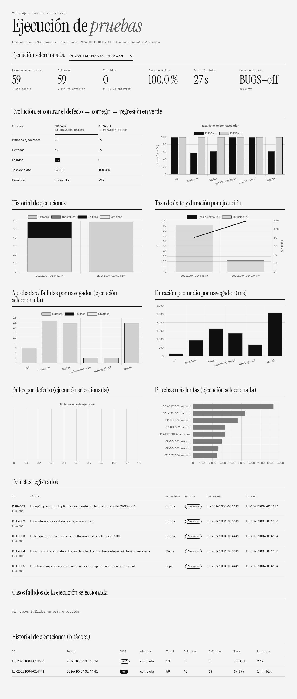
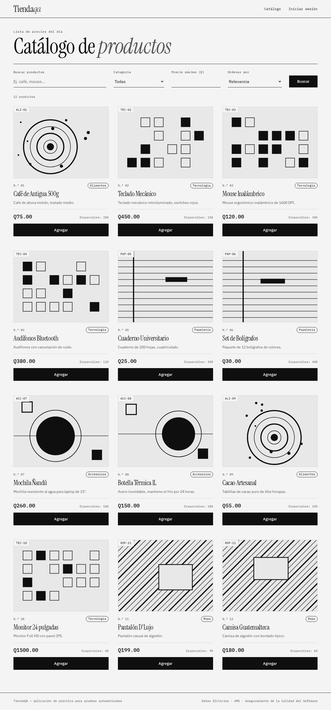
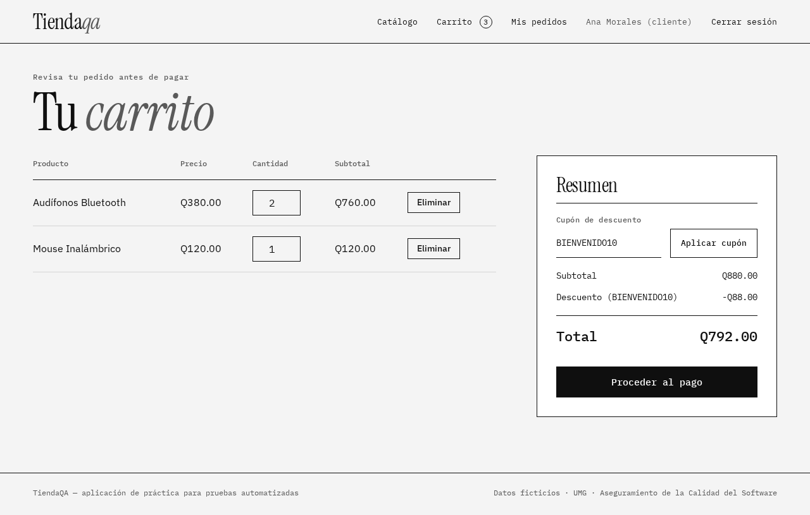
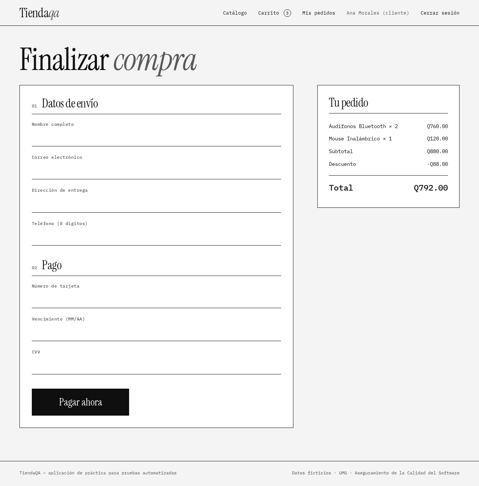
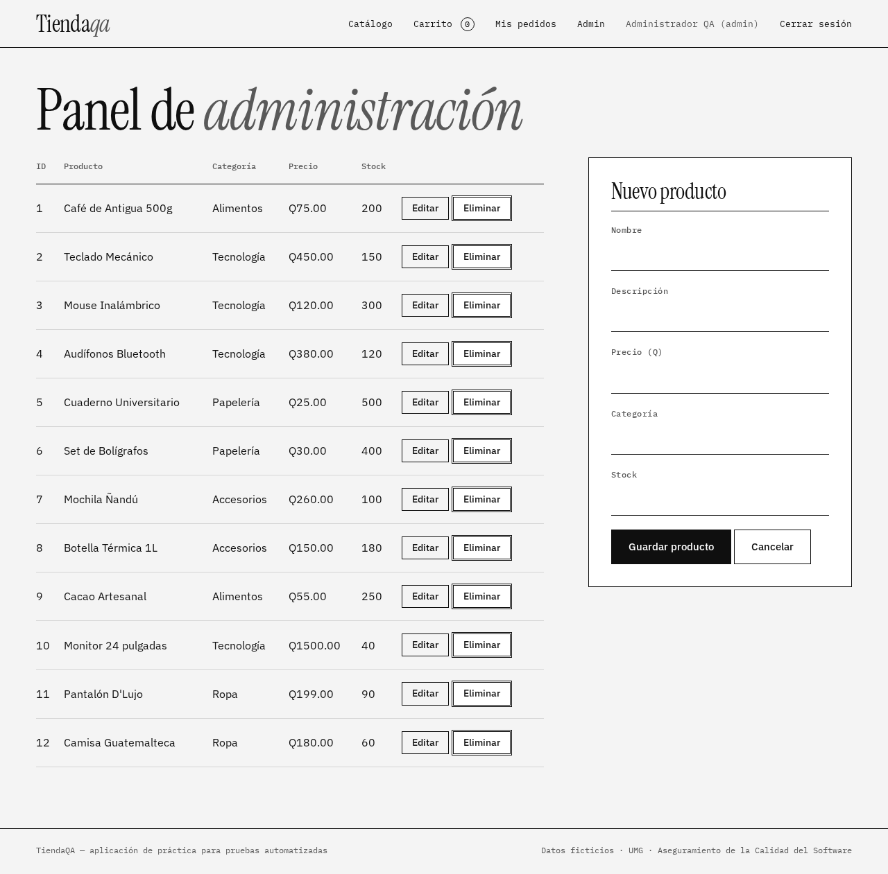

# TiendaQA · Playwright para Aseguramiento de la Calidad del Software

Proyecto académico de la **Universidad Mariano Gálvez de Guatemala** (curso de Aseguramiento de la Calidad del Software). Demuestra, con una aplicación propia y reproducible, las capacidades de **Playwright** y el proceso de pruebas completo **ENTRADAS → EJECUCIÓN → SALIDAS**, donde cada artefacto es un archivo real del repositorio.

| | |
|---|---|
| **Aplicación bajo prueba (SUT)** | *TiendaQA*: tienda en línea con login y roles, catálogo, carrito, cupones, checkout, pedidos y panel admin (Node.js + Express + SQLite + frontend vanilla) |
| **Herramienta** | Playwright 1.63.0 con TypeScript estricto |
| **Casos de prueba** | **25 casos** completos (varios pasos y datos cada uno) que generan **59 ejecuciones** (Chromium, Firefox, WebKit, Pixel 7, iPhone 14 y API) |
| **Defectos intencionales** | 5, activables con `BUGS=on` y corregidos con `BUGS=off` |
| **Resultado de referencia** | `BUGS=on` → 40 exitosas y **19 fallidas** (5 defectos) · `BUGS=off` → **59 de 59** |



> **¿Por dónde empezar?** Lee la [**guía de funcionamiento del proyecto**](docs/00-guia-del-proyecto.md): explica qué hace cada parte, con qué entradas, cómo procesa y qué produce.

## Inicio rápido

```bash
npm install                 # dependencias
npx playwright install      # Chromium, Firefox y WebKit
npm run ciclo:completo      # ciclo completo (≈ 2.5 min): con defectos → defectos DEF-XXX → corregido → reportes
npm run navegador           # ver al navegador interactuando (con defectos: varios recorridos fallan a la vista)
```

Para solo ver la aplicación: `npm run db:reset && npm run app` y abrir <http://localhost:3100>.
Documentación completa: [docs/](docs/).

## Requisitos

- **Node.js 22 o superior** (Playwright 1.63 requiere 22, 24 o 26) y npm.
- 4 GB de RAM y unos 3 GB de disco (los navegadores ocupan ≈ 1.3 GB).
- Linux, macOS o Windows. Alternativa sin instalar nada: **Docker** (ver más abajo).
- No requiere Java: el reporte Allure usa Allure 3.

Instalación paso a paso en Linux, Windows y Docker: [docs/07-configuracion-ambiente.md](docs/07-configuracion-ambiente.md).

## La aplicación y sus defectos

| Pantalla | Captura |
|---|---|
| Catálogo con búsqueda y filtros |  |
| Carrito con cupón |  |
| Checkout validado |  |
| Panel de administración |  |

Interfaz propia, minimalista y monocromática: solo negro, blanco y grises, con tipografía serif grande contra mono pequeña (Instrument Serif e IBM Plex, licencia OFL, incluidas en `app/public/fonts/`) y **placeholders geométricos en SVG** generados por producto según su categoría. Se ve igual sin internet.

Usuarios de prueba: `admin@tiendaqa.com / Admin123!` (admin) · `ana@tiendaqa.com / Cliente123!` (cliente). Cupones: `BIENVENIDO10`, `VERANO20`, `FIJO50`. API documentada en <http://localhost:3100/api-docs>.

La variable **`BUGS`** (`on` por defecto, `off` para corregir) activa o desactiva estos defectos:

| ID | Defecto | Cómo se detecta |
|---|---|---|
| BUG-001 | El cupón porcentual descuenta el doble en compras de Q500 o más | Funcional, datos y API |
| BUG-002 | El carrito acepta cantidades negativas | Funcional y API |
| BUG-003 | La búsqueda con `ñ`, tildes o `'` devuelve error 500 | Funcional y API |
| BUG-004 | El campo «Dirección» del checkout no tiene `<label>` | Accesibilidad (axe-core) |
| BUG-005 | El botón «Pagar ahora» cambia de aspecto | Regresión visual |

Con `BUGS=on` las pruebas de detección **fallan**; con `BUGS=off` **pasan**: así se muestra «encontrar el defecto → corregir → regresión en verde». Detalle: [docs/09](docs/09-hallazgo-de-defectos.md).

## Comandos

### Aplicación y datos

| Comando | Qué hace |
|---|---|
| `npm run app` | Levanta TiendaQA en el puerto 3100 con defectos activos (`BUGS=on`) |
| `npm run app:fixed` | Igual, con los defectos corregidos |
| `npm run db:reset` | Reinicia la base con `db/schema.sql` + `db/seed.sql` |

### Pruebas

| Comando | Qué hace |
|---|---|
| `npm test` | Suite completa (los 25 casos, 59 ejecuciones) |
| `npm run test:smoke` | Camino crítico `@smoke` (10 ejecuciones, ≈ 15 s) |
| `npm run test:regression` | Todo lo etiquetado `@regression` |
| `npm run test:api` | Solo API |
| `npm run test:visual` | Regresión visual `@visual` |
| `npm run test:visual:update` | Regenera la línea base visual (con `BUGS=off`) |
| `npm run test:a11y` | Accesibilidad `@a11y` |
| `npm run test:mobile` | Móvil `@mobile` (Pixel 7 e iPhone 14) |
| `npm run test:headed` | Ver el navegador (Chromium) |
| `npm run test:ui` | UI Mode de Playwright (línea de tiempo, selector de locators) |
| `npm run codegen` | Grabar un test (la app debe estar en `http://localhost:3100`) |

Para elegir el modo de la aplicación en cualquier comando: `BUGS=off npm test` (Linux/macOS), `$env:BUGS="off"; npm test` (PowerShell).

### Reportes y bitácora

| Comando | Qué hace |
|---|---|
| `npm run report` | Reporte HTML nativo de Playwright |
| `npm run report:allure` | Genera y abre el reporte Allure |
| `npm run dashboard` | Regenera `reports/dashboard/index.html` |
| `npm run bitacora -- "SELECT …"` | Consulta SQL sobre `reports/bitacora.db` |
| `npm run reportes:limpiar` | Borra bitácora, informes y resultados anteriores |

### Ciclo de pruebas y recorridos visuales

| Comando | Qué hace |
|---|---|
| `npm run test:bugs` | Suite con `BUGS=on` (se esperan fallos) |
| `npm run test:fixed` | Suite con `BUGS=off` (regresión en verde) |
| **`npm run ciclo:completo`** | Reinicia BD → corre con defectos → genera DEF-XXX → corre corregido → informe, dashboard comparativo y abre los reportes |
| **`npm run navegador`** | **Navegador visible y maximizado** con 10 recorridos de las operaciones críticas de un e-commerce (cursor, ondas de clic, escritura letra por letra y subtítulos). Con los defectos activos (`BUGS=on`): **5 limpios pasan y 5 con defecto fallan a la vista** con el aviso «DEFECTO DETECTADO» |
| `npm run navegador:fallas` · `:aciertos` | Solo los 5 recorridos con defecto · solo los 5 limpios |
| `npm run navegador:corregido` | Los 10 recorridos con la app corregida (`BUGS=off`): todos pasan |
| `npm run navegador:grabar` | Igual que el primero, grabando un video en `test-results/` |
| `npm run reportes:abrir` / `reportes:detener` | Abre / detiene los reportes de la última ejecución |
| `npm run traza` | Abre en el Trace Viewer la traza de un fallo |

### Calidad y documentación

| Comando | Qué hace |
|---|---|
| `npm run typecheck` · `lint` · `format` | TypeScript estricto, ESLint y Prettier |
| `npm run docs:casos` | Regenera la matriz de casos, el CSV, la trazabilidad y el cuadro de defectos desde los tests |
| `npm run docs:verificar` | Verifica los documentos (00 a 12), sus enlaces y diagramas |

## Estructura del repositorio y proceso de pruebas

Cada carpeta corresponde a un artefacto del modelo **ENTRADAS → EJECUCIÓN → SALIDAS**:

```text
.
├── app/                        EJECUCIÓN · Aplicación bajo prueba (Express + SPA vanilla)
├── db/                         ENTRADA   · schema.sql y seed.sql (datos de prueba)
├── test-data/                  ENTRADA   · Datasets JSON/CSV y catálogos (casos, defectos)
├── docs/                       ENTRADA y SALIDA · Guía (00) y los 12 documentos del proceso
│   └── img/                               Capturas usadas en este README
├── tests/
│   ├── pages/                  EJECUCIÓN · Componentes de prueba (Page Object Model)
│   ├── fixtures/               EJECUCIÓN · Fixtures personalizadas
│   ├── support/                EJECUCIÓN · Cliente de API, metadatos, datos, esquemas
│   ├── e2e/ data-driven/ api/  EJECUCIÓN · Scripts de prueba funcionales, por datos y de API
│   ├── network/ visual/ a11y/  EJECUCIÓN · Mocking de red, regresión visual y accesibilidad
│   ├── mobile/ bugs/           EJECUCIÓN · Móvil y detección de defectos
│   ├── recorridos/             Recorridos para ver el navegador trabajando (solo con RECORRIDOS=1)
│   ├── reporters/              SALIDA    · Reporter de bitácora, informes, defectos y dashboard
│   └── global-setup.ts         EJECUCIÓN · Reinicio de BD y sesiones
├── playwright.config.ts        ENTRADA   · Configuración (proyectos, reporteres, ambiente)
├── Dockerfile · docker-compose.yml   ENTRADA · Ambiente reproducible
├── .github/workflows/          EJECUCIÓN · Integración continua
├── scripts/                    Utilidades (ciclo de pruebas, reportes, bitácora, documentación)
│
├── reports/                    SALIDA (generada)
│   ├── bitacora.db                    Bitácora SQLite (test_logs, ejecuciones, defectos)
│   ├── informe-ejecucion.md           Informe de ejecución
│   ├── defectos/DEF-XXX.md            Un reporte por defecto
│   ├── evidencias/                    Capturas, videos, trazas
│   └── dashboard/index.html           Dashboard (Chart.js)
├── playwright-report/          SALIDA (generada) · Reporte HTML nativo
└── allure-report/              SALIDA (generada) · Reporte Allure
```

### Mapa de artefactos del proceso

| Fase | Artefacto | Dónde está |
|---|---|---|
| **GUÍA** | Cómo funciona todo el proyecto | [docs/00-guia-del-proyecto.md](docs/00-guia-del-proyecto.md) |
| **ENTRADA** | Plan de pruebas | [docs/01-plan-de-pruebas.md](docs/01-plan-de-pruebas.md) |
| | Casos de prueba | [docs/02-casos-de-prueba.md](docs/02-casos-de-prueba.md) · [CSV](docs/casos-de-prueba.csv) |
| | Requerimientos y trazabilidad | [docs/03-requerimientos-y-trazabilidad.md](docs/03-requerimientos-y-trazabilidad.md) |
| | Modelo de diseño | [docs/04-modelo-de-diseno.md](docs/04-modelo-de-diseno.md) |
| | Datos de prueba | [docs/05-datos-de-prueba.md](docs/05-datos-de-prueba.md) · `db/` · `test-data/` |
| | Guía de pruebas | [docs/06-guia-de-pruebas.md](docs/06-guia-de-pruebas.md) |
| | Configuración del ambiente | [docs/07-configuracion-ambiente.md](docs/07-configuracion-ambiente.md) · `Dockerfile` |
| **EJECUCIÓN** | Componentes de prueba (POM) | `tests/pages/` |
| | Scripts de prueba | `tests/**/*.spec.ts` |
| | Ambiente y datos en ejecución | `app/` · `playwright.config.ts` · `.github/workflows/` |
| **SALIDA** | Bitácora y reportes | [docs/08-bitacora-y-reportes.md](docs/08-bitacora-y-reportes.md) · `reports/` |
| | Hallazgo de defectos | [docs/09-hallazgo-de-defectos.md](docs/09-hallazgo-de-defectos.md) · `reports/defectos/` |
| | Solicitudes de cambio | [docs/10-solicitud-de-cambios.md](docs/10-solicitud-de-cambios.md) |
| | Actualización de documentos | [docs/11-actualizacion-documentos.md](docs/11-actualizacion-documentos.md) |
| **EXTRA** | Playwright: ventajas y limitaciones | [docs/12-playwright-ventajas-limitaciones.md](docs/12-playwright-ventajas-limitaciones.md) |

## Capacidades de Playwright demostradas

| Capacidad | Dónde verla |
|---|---|
| E2E con Page Object Model y fixtures | `tests/e2e/`, `tests/pages/`, `tests/fixtures/` |
| Pruebas dirigidas por datos (JSON y CSV) | `tests/data-driven/`, `test-data/` |
| API testing y encadenado API + UI | `tests/api/` |
| Multinavegador (Chromium, Firefox, WebKit) y móvil (Pixel 7, iPhone 14) | `playwright.config.ts` |
| Mocking e interceptación de red | `tests/network/` |
| Regresión visual | `tests/visual/` |
| Accesibilidad con axe-core | `tests/a11y/` |
| Trazas, video y capturas en fallos | `trace: 'on-first-retry'`; `npm run traza` |
| Navegador visible y en cámara lenta (recorridos visuales) | `tests/recorridos/`; `npm run navegador` |
| Reportes: HTML, Allure, JUnit, JSON, bitácora y dashboard | `reports/`, `playwright-report/`, `allure-report/` |

## Docker

```bash
export HOST_UID=$(id -u) HOST_GID=$(id -g)          # Linux/macOS: los reportes quedan a tu nombre
docker compose build pruebas
BUGS=off docker compose run --rm pruebas            # regresión: 59 de 59
BUGS=on  docker compose run --rm pruebas            # detección: 19 fallos esperados
docker compose up app                               # solo la aplicación en :3100
```

## Integración continua

[`.github/workflows/playwright.yml`](.github/workflows/playwright.yml) ejecuta, en el contenedor oficial de Playwright:
1. **Calidad**: tipos, lint, formato y documentación.
2. **Pruebas por proyecto** (matriz: `api`, `chromium`, `firefox`, `webkit`, `mobile-pixel7`, `mobile-iphone14`) con `BUGS=off`. Publica como artefactos el reporte HTML, Allure, la bitácora, los informes y las trazas.
3. **Reporte Allure combinado** de todos los proyectos.
4. **Detección de defectos**: con `BUGS=on` exige que las pruebas **fallen** (si pasaran, las pruebas no estarían detectando nada).

## Convenciones

- Cada caso tiene un ID trazable en el título (`CP-E2E-004`) y declara su requerimiento con `meta()`. Ver [docs/06](docs/06-guia-de-pruebas.md).
- Etiquetas: `@smoke`, `@regression`, `@api`, `@visual`, `@a11y`, `@mobile`.
- Cero esperas fijas (ESLint lo impide), selectores por rol/etiqueta/`data-testid` y pruebas independientes y paralelizables.

## Problemas frecuentes

| Síntoma | Solución |
|---|---|
| `Executable doesn't exist` | `npx playwright install` |
| Fallan solo las pruebas `@visual` | `npm run test:visual:update` (las capturas dependen del sistema operativo y las tipografías) |
| Puerto 3100 o 3101 ocupado | `PORT=3200 npm run app` · `TEST_PORT=3201 npm test` · `npm run reportes:detener` |
| No aparecen bitácora ni informes | No pases `--reporter=…`: sobrescribe los reporteres de la configuración |
| Una prueba aparece como *Inestable* | La bitácora la registra a propósito (falló y pasó al reintentar): ver `npm run bitacora -- "SELECT * FROM test_logs WHERE estado='Inestable'"` |

Más soluciones en [docs/07 §7](docs/07-configuracion-ambiente.md).
