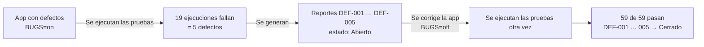
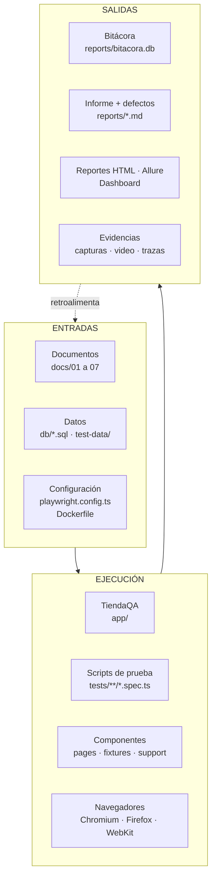
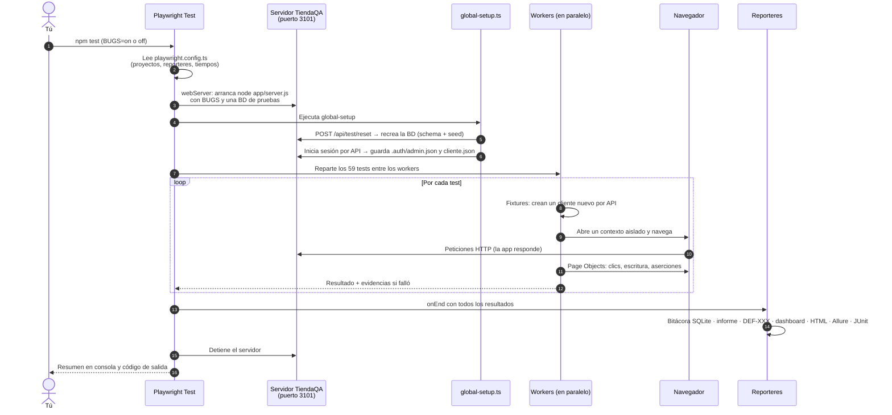
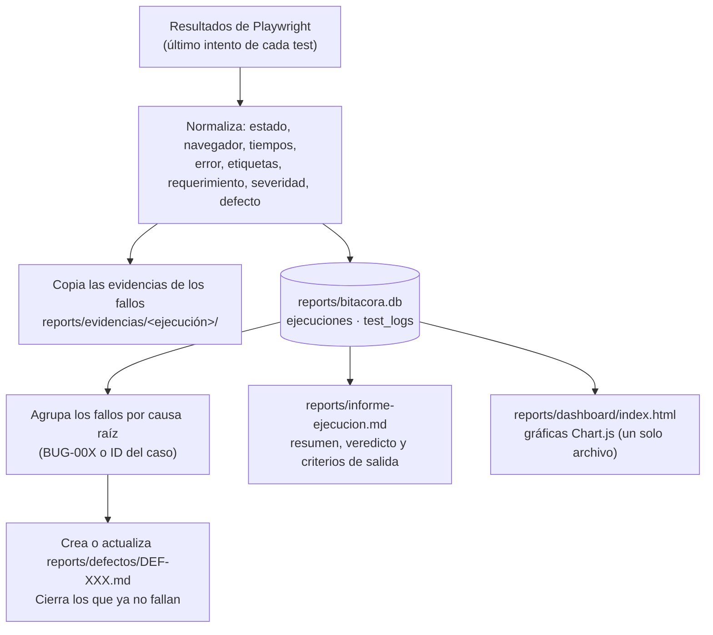
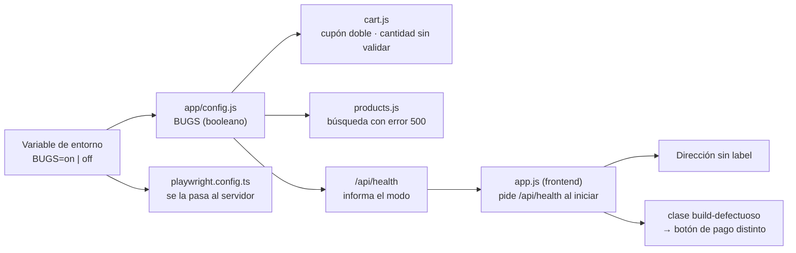

# 00 — Guía de funcionamiento del proyecto

> Esta es la guía para **entender todo el proyecto de una sola lectura**: qué es cada pieza, qué recibe (**entradas**), cómo trabaja (**procesamiento**) y qué entrega (**salidas**). Los demás documentos (01 a 12) profundizan en cada tema; este los une.

## 1. El proyecto en una página

**Problema que resuelve.** Para aprender y demostrar el Aseguramiento de la Calidad del Software hace falta un sistema que se pueda probar de forma repetible. Este proyecto construye ese sistema completo.

**Las tres piezas**

| Pieza | Qué es | Dónde está |
|---|---|---|
| **1. TiendaQA** (la aplicación bajo prueba) | Una tienda en línea con login, catálogo, carrito, cupones, pago, pedidos y panel de administración. Contiene **5 defectos sembrados a propósito** que se encienden con `BUGS=on` | `app/`, `db/` |
| **2. La suite de pruebas** | 25 casos de prueba automatizados con Playwright, cada uno con varios pasos, que se ejecutan 59 veces (3 navegadores, 2 móviles emulados y API). Sus pruebas **deben fallar** si la aplicación tiene defectos y **pasar** si no los tiene | `tests/` |
| **3. El sistema de salidas** | Registra cada ejecución en una bitácora, redacta informes y un reporte por cada defecto, y dibuja un dashboard | `tests/reporters/`, `reports/` |

**El ciclo que recorre el proyecto**



> **Idea clave:** `BUGS` es un interruptor. Con `on` la aplicación se comporta mal en 5 puntos; con `off` se comporta bien. Las pruebas son las mismas; lo único que cambia es el resultado. Así se demuestra que **las pruebas realmente detectan defectos**.

## 2. Mapa general



## 3. Qué pasa cuando ejecutas `npm test` (paso a paso)



| # | Paso | Entrada | Qué hace | Salida |
|---|---|---|---|---|
| 1 | **Configuración** | `playwright.config.ts`, variables de entorno (`BUGS`, `CI`…) | Define 6 proyectos (navegadores/dispositivos), reintentos, tiempos y reporteres | Plan de ejecución |
| 2 | **Servidor de la app** | `BUGS`, puerto 3101, `db/tienda-test.db` | Levanta TiendaQA y espera a que `/api/health` responda | App lista |
| 3 | **Preparación global** | `db/schema.sql` + `db/seed.sql` | Reinicia la BD y deja sesiones listas para admin y cliente | BD en estado conocido; `.auth/*.json` |
| 4 | **Reparto** | Los 59 tests | Los distribuye entre *workers* (cada uno con su navegador) | Ejecución paralela |
| 5 | **Fixtures** | Cada test | Crean sus propios datos: un cliente nuevo, un carrito con producto… | Test independiente |
| 6 | **Test** | Page Objects, datos | Interactúa con la app y comprueba resultados con aserciones | Pasa o falla |
| 7 | **Evidencia** | Un test que falla | Guarda captura, video y (en el reintento) traza | Archivos en `test-results/` |
| 8 | **Reporteres** | Todos los resultados | Generan bitácora, informes, defectos y dashboard | Carpeta `reports/` y reportes HTML |

## 4. Cada componente: qué hace, entradas, proceso y salidas

### 4.1 La aplicación bajo prueba (`app/`)

| Parte | Qué hace | Entradas | Procesamiento | Salidas |
|---|---|---|---|---|
| `server.js` | Arranca Express y une todas las rutas | `PORT`, `BUGS`, `DB_FILE` | Registra `/api/auth`, `/api/products`, `/api/cart`, `/api/orders`, `/api/health`, `/api/test/reset` y sirve el frontend | Un servidor web |
| `config.js` | Lee las variables de entorno | `BUGS` (`on` por defecto) | Convierte el texto en un booleano | Interruptor de defectos |
| `db.js` | Abre SQLite y sabe reiniciarla | `db/schema.sql`, `db/seed.sql` | Ejecuta ambos scripts | Base de datos con datos semilla |
| `middleware.js` | Protege rutas | Cabecera `Authorization: Bearer <token>` | Busca el token en `sessions` y revisa el rol | `401`, `403` o permite pasar |
| `routes/auth.js` | Login, registro y logout | Correo y contraseña | Compara el hash `sha256`; crea un token aleatorio | Token y usuario |
| `routes/products.js` | Catálogo y CRUD de administración | Filtros (`q`, `category`, `maxPrice`, `sort`) o datos del producto | Filtra sin distinguir tildes; valida datos | Lista o producto JSON |
| `routes/cart.js` | Carrito y cupones | Producto, cantidad o código de cupón | Calcula subtotal, descuento y total **en centavos** | Carrito con totales |
| `routes/orders.js` | Checkout y pedidos | Datos de envío y pago | Valida cada campo, rechaza la tarjeta terminada en `0002`, descuenta el stock en una transacción | Pedido o error `400/402/409` |
| `public/` (frontend) | La interfaz web: una página que cambia de vista según el hash (`#/catalogo`, `#/carrito`…) | Acciones del usuario | Llama a la API con `fetch` y dibuja las vistas | Pantallas HTML |

**Dónde viven los 5 defectos** (todos dependen de `BUGS`):

| Defecto | Archivo | Qué hace con `BUGS=on` |
|---|---|---|
| BUG-001 | `app/routes/cart.js` → `calcDiscountCents()` | Con subtotal ≥ Q500 duplica el porcentaje del cupón |
| BUG-002 | `app/routes/cart.js` → `validQuantity()` | No valida la cantidad (acepta negativos) |
| BUG-003 | `app/routes/products.js` | Un texto con `ñ`, tildes o `'` provoca error 500 |
| BUG-004 | `app/public/js/app.js` → `fieldHtml()` | El campo «Dirección» se dibuja sin `<label>` |
| BUG-005 | `app/public/css/styles.css` → `.btn-pay` | El botón de pago cambia de color y de forma |

### 4.2 Los datos

| Parte | Qué es | Quién lo usa | Salida |
|---|---|---|---|
| `db/schema.sql` | Crea las 8 tablas (borra las anteriores) | `db.js`, `global-setup.ts` | Estructura vacía |
| `db/seed.sql` | 4 usuarios, 12 productos y 4 cupones | Igual | Datos de partida |
| `test-data/login.json`, `checkout-negativos.json` | Casos de login y de checkout inválido, con valores límite | Pruebas data-driven | **Una fila = un paso** de un caso |
| `test-data/checkout-positivos.csv`, `cupones.csv` | Compras válidas y combinaciones de cupones | Pruebas data-driven | Una fila = un paso de un caso |
| `test-data/productos-visual.json` | 4 productos congelados | Prueba visual del catálogo | Captura reproducible |
| `test-data/casos-detalle.json`, `defectos-catalogo.json` | Pasos y resultados esperados de casos y defectos | Generadores de documentos y de defectos | Textos de los documentos |

### 4.3 El motor de pruebas (`playwright.config.ts` y `tests/`)

| Parte | Qué hace | Entradas | Procesamiento | Salidas |
|---|---|---|---|---|
| `playwright.config.ts` | Es el «panel de control» | Variables de entorno | Declara proyectos, reintentos (1 local, 2 en CI), `webServer`, reporteres y rutas de capturas | Configuración |
| `tests/global-setup.ts` | Prepara la corrida | La app ya levantada | Reinicia la BD y guarda las sesiones de admin y cliente | BD limpia y `.auth/` |
| `tests/fixtures/index.ts` | Entrega a cada test lo que necesita ya preparado | Nombre del test, API | **`clienteNuevo`** registra un cliente único; **`paginaCliente`** abre el navegador con su sesión; **`carritoUI`** además le agrega un producto; **`adminApi`** inicia sesión como admin; **`trazabilidad`** (automática) publica el requerimiento y la severidad en Allure | Objetos listos para usar |
| `tests/pages/*.ts` (POM) | Cada pantalla como una clase: sabe **dónde** están sus elementos y **qué se puede hacer** en ella | La `Page` de Playwright | Localiza por rol, etiqueta o `data-testid` | Métodos como `aplicarCupon('BIENVENIDO10')` |
| `tests/support/api-client.ts` | Habla con la API sin navegador | Token y datos | Hace peticiones HTTP y devuelve la respuesta | `APIResponse` |
| `tests/support/meta.ts` | Etiqueta cada test con requerimiento, severidad, épica, feature y defecto | Datos del caso | Los guarda como *annotations* | Trazabilidad |
| `tests/support/datos.ts`, `esquemas.ts`, `a11y.ts`, `productos.ts`, `dinero.ts` | Utilidades: leer JSON/CSV, validar el contrato de la API, ejecutar axe-core, buscar productos, convertir «Q1,350.00» en número | — | — | Funciones reutilizables |

### 4.4 Las suites de pruebas

La suite tiene **25 casos**. Cada uno es un escenario **completo** (varios pasos y varios datos), no una verificación suelta; por eso son pocos y fáciles de explicar. Dentro de cada caso los pasos se ven en los reportes (`test.step`).

| Suite (`tests/…`) | Casos | Qué verifica | Cómo lo hace | Resultado con `BUGS=on` |
|---|---|---|---|---|
| `e2e/` | 7 | Compra completa, autenticación y roles, catálogo, carrito y cupones, checkout, administración y pedidos | Page Objects sobre la interfaz | Pasan |
| `data-driven/` | 3 | Login, checkout y cupones con muchos datos (válidos, inválidos y límite) | Cada fila de un JSON/CSV es un **paso**; el caso reporta todas las filas que fallen | Falla `CP-DD-003` (filas de Q500 o más) |
| `api/` | 5 + 1 | Autenticación, catálogo, administración, carrito/cupones y pedidos; más una integración API + UI | `request` de Playwright, sin navegador | Pasan |
| `network/` | 1 | Interfaz ante API caída, lenta, vacía, sin stock y sesión expirada | **`page.route`** intercepta y falsea las respuestas | Pasa |
| `visual/` | 1 | Que la apariencia no cambie (login, catálogo, checkout y botón de pago) | `toHaveScreenshot` contra una línea base | **Falla** (BUG-005) |
| `a11y/` | 1 | Accesibilidad WCAG 2.1 A/AA de 5 pantallas | axe-core | **Falla** (BUG-004) |
| `mobile/` | 2 | Menú hamburguesa y compra completa en pantalla pequeña | Emulación de Pixel 7 e iPhone 14 | Pasan |
| `bugs/` | 4 | Detecta uno por uno los defectos de cupones, cantidades, búsqueda y etiquetas | Aserciones *soft* sobre el comportamiento correcto | **Fallan** (es su propósito) |

> **Cómo se «detecta» un defecto:** la prueba afirma el comportamiento **correcto** (p. ej. «el descuento debe ser -Q150.00»). Con `BUGS=on` la aplicación entrega -Q300.00 y la aserción falla. Con `BUGS=off` entrega -Q150.00 y pasa.

### 4.5 Los reporteres (las salidas)

Playwright llama a todos los reporteres configurados cuando termina. Cada uno produce un tipo de salida:

| Reportero | Entrada | Procesamiento | Salida |
|---|---|---|---|
| `list` | Resultados en vivo | Imprime cada test | Texto en la terminal |
| `html` | Resultados + adjuntos | Genera un sitio navegable | `playwright-report/` |
| `allure-playwright` | Resultados + metadatos | Escribe un JSON por test | `allure-results/` → `npm run report:allure` → `allure-report/` |
| `junit`, `json` | Resultados | Serializa | `reports/junit.xml`, `reports/resultados.json` (para CI) |
| **`bitacora-reporter.ts`** | Todos los tests, con su último intento | Detalle abajo | Bitácora, informe, defectos, evidencias y dashboard |

**Qué hace por dentro `bitacora-reporter.ts`:**



### 4.6 Generadores y utilidades (`scripts/`)

| Script | Entrada | Qué hace | Salida |
|---|---|---|---|
| `generar-docs.ts` (`npm run docs:casos`) | La lista de tests de Playwright + `test-data/` | Arma la matriz de casos y la trazabilidad **desde el código** | `docs/02`, CSV, bloques de `docs/03` y `docs/09` |
| `verificar-docs.js` (`docs:verificar`) | `docs/` | Revisa que existan los documentos, que los enlaces funcionen y que no haya bloques vacíos | Informe en consola |
| `consultar-bitacora.js` (`npm run bitacora -- "SQL"`) | Una consulta SQL | La ejecuta en modo lectura sobre la bitácora | Tabla en consola |
| `db-reset.js` | `db/*.sql` | Reinicia la BD de desarrollo | `db/tienda.db` |
| `ciclo-completo.js` (`npm run ciclo:completo`) | — | Orquesta el ciclo completo (ver §6) | Todos los reportes |
| `reportes-abrir.js` / `reportes-detener.js` | Reportes generados | Abre o cierra los servidores de reportes | Navegador con los reportes |
| `abrir-traza.js` | Bitácora | Abre la traza de un fallo en el Trace Viewer | Trace Viewer |
| `capturas.js` | App temporal | Toma capturas para el README | `docs/img/*.png` |

### 4.7 Ambientes: CI y Docker

| Parte | Qué hace | Entrada | Salida |
|---|---|---|---|
| `Dockerfile` + `docker-compose.yml` | Ejecutan todo en un contenedor idéntico para todo el equipo | Código del proyecto | Mismos resultados que en tu equipo, sin instalar nada |
| `.github/workflows/playwright.yml` | En cada *push*: revisa la calidad, corre la suite por navegador con `BUGS=off`, une el Allure y **exige que con `BUGS=on` las pruebas fallen** | Repositorio | Artefactos: reportes, bitácora, trazas |

## 5. Cómo funciona el interruptor `BUGS`



La suite no «sabe» en qué modo está: simplemente comprueba el comportamiento correcto. Por eso el mismo código de pruebas detecta los defectos (`on`) o pasa en verde (`off`).

## 6. El ciclo completo: `npm run ciclo:completo`

| Paso | Qué hace | Salida |
|---|---|---|
| 1 | Borra reportes anteriores y reinicia la BD | Estado limpio |
| 2 | Ejecuta la suite con `BUGS=on` | 19 fallos, bitácora y evidencias |
| 3 | Lista los defectos generados | `DEF-001 … DEF-005 [Abierto]` |
| 4 | Ejecuta la suite con `BUGS=off` | 59 de 59; los defectos pasan a `Cerrado` |
| 5 | Genera Allure y el dashboard comparativo | `allure-report/`, `reports/dashboard/` |
| 6 | Imprime la comparación y **verifica por sí mismo** que con `on` hubo fallos y con `off` ninguno | Mensaje `Ciclo correcto` y código de salida |
| 7 | Abre dashboard, reporte de Playwright y Allure | Navegador |

### 6.1 Ver el navegador en acción: `npm run navegador`

Es una segunda forma de ejecutar, pensada para **ver** a Playwright trabajar en una ventana real (maximizada), no solo leer resultados. Son **10 recorridos de las operaciones críticas de un e-commerce**: 5 limpios y 5 que detectan un defecto cada uno.

| Comando | Qué muestra |
|---|---|
| `npm run navegador` | Los 10 recorridos con la app **con defectos** (`BUGS=on`): **5 pasan y 5 fallan a la vista** |
| `npm run navegador:fallas` | Solo los 5 recorridos que detectan defectos |
| `npm run navegador:aciertos` | Solo los 5 recorridos limpios |
| `npm run navegador:corregido` | Los 10 con la app corregida (`BUGS=off`): todos pasan |
| `npm run navegador:grabar` | Igual que el primero, grabando un video en `test-results/` |

Qué se ve en pantalla:
- **Cursor** y una **onda en cada clic**, para seguir lo que hace el robot; la ventana ocupa toda la pantalla.
- **Escritura letra por letra**, como una persona.
- **Barra de subtítulos** abajo: ID del recorrido, el paso actual («Paso 4 de 7 · …») y el modo de la app (`BUGS=on|off`).
- Tras cada verificación, un aviso breve: «Correcto — …» o, si falla, **`DEFECTO DETECTADO — … Expected: "-Q150.00" · Received: "-Q300.00"`** con la barra invertida (fondo blanco). El recorrido **continúa**, así un mismo caso puede mostrar varios defectos.
- Al final, un resumen: «RECORRIDO CON DEFECTOS (5 detectados)» o «Recorrido superado».

| Recorrido | Qué hace | Con defectos (`on`) | Corregido (`off`) |
|---|---|---|---|
| `CP-REC-001` | **Compra completa:** inicia sesión, busca «mouse», lo agrega, aplica el cupón, paga y verifica el pedido | Pasa | Pasa |
| `CP-REC-002` | **Cupones en compras grandes (BUG-001):** Monitor con BIENVENIDO10, 2 audífonos con VERANO20 y compra de Q500 en el umbral | **Falla** (5 diferencias en descuentos y totales) | Pasa |
| `CP-REC-003` | **Autenticación y roles:** clave errónea, formulario vacío, usuario bloqueado, cliente sin acceso al panel, cierre de sesión, ruta protegida y administrador | Pasa | Pasa |
| `CP-REC-004` | **Cantidades inválidas (BUG-002):** -3, 0 y 100 en el carrito | **Falla** (4: total negativo, en cero y de Q2,500) | Pasa |
| `CP-REC-005` | **Catálogo:** búsqueda, «CAFE» sin tildes, sin resultados y filtros combinados | Pasa | Pasa |
| `CP-REC-006` | **Búsqueda con caracteres especiales (BUG-003):** «café», «Ñandú» y «D'Lujo» | **Falla** (error del catálogo en las 3) | Pasa |
| `CP-REC-007` | **Carrito y cupones:** cantidades, eliminar, cupones inválidos, FIJO50 con su mínimo | Pasa | Pasa |
| `CP-REC-008` | **Accesibilidad del checkout (BUG-004):** cada campo debe tener etiqueta accesible | **Falla** («Dirección de entrega» sin etiqueta) | Pasa |
| `CP-REC-009` | **Checkout robusto:** vacío, valores límite, tarjeta declinada, corrección y pago | Pasa | Pasa |
| `CP-REC-010` | **Aspecto del botón de pago (BUG-005):** color, esquinas y letras, y que el pago siga funcionando | **Falla** (3: color, forma y espaciado) | Pasa |

Para ver solo algunos recorridos se filtra por ID: `npm run navegador -- -g "CP-REC-001|CP-REC-002"`.

**Ajustar la velocidad** (variables de entorno):

| Variable | Por defecto | Efecto |
|---|---|---|
| `SLOWMO` | `500` ms | Pausa entre acciones de Playwright (más alto = más lento) |
| `RECORRIDOS_PAUSA` | `900` ms | Tiempo que se queda cada subtítulo en pantalla |
| `RECORRIDOS_ESCRITURA` | `55` ms | Tiempo entre letras al escribir |
| `RECORRIDOS_FOTOS` | — | Carpeta donde guardar una captura por paso |
| `RECORRIDOS_HEADLESS` | — | Con cualquier valor, sin ventana (para servidores sin pantalla) |
| `RECORRIDOS_PANTALLA_COMPLETA` | — | Con cualquier valor, pantalla completa tipo F11 en lugar de maximizada |

Ejemplos: `SLOWMO=900 npm run navegador` (Linux/macOS) · `$env:SLOWMO=900; npm run navegador` (PowerShell).

> Estos recorridos **no forman parte de la suite de regresión**: el proyecto `recorridos` solo existe cuando se define `RECORRIDOS=1` (lo hacen los scripts), no escribe en la bitácora y sus pausas narrativas son la única excepción a la regla de «cero esperas fijas».

## 7. Un caso de punta a punta

### 7.1 `CP-E2E-004` — «Carrito y cupones: cantidades, eliminación y reglas de cada cupón»

1. **Definición** (`tests/e2e/carrito.spec.ts`): título con el ID, etiquetas `@regression` y `meta({ req: 'RF-05, RF-06', severidad: 'critical' })`. Son 8 pasos (`test.step`) en un solo caso.
2. **Fixture `paginaCliente`**: registra un cliente nuevo por API y abre el navegador con su sesión ya iniciada.
3. **Page Objects** (`CatalogPage` y `CartPage`): `agregarAlCarrito()`, `cambiarCantidad()`, `eliminar()` y `aplicarCupon()` encapsulan los selectores.
4. **La aplicación**: cada acción llama a `/api/cart/...`; `cart.js` recalcula subtotal, descuento y total en centavos y responde el carrito.
5. **Aserciones**: subtotales de Q220.00 y Q100.00, cupones inexistente y expirado rechazados, FIJO50 con su mínimo de Q200 (rechazado con Q100, aplicado con Q250: -Q50.00) y BIENVENIDO10 reemplazándolo (-Q25.00). Playwright reintenta cada aserción hasta que se cumple o vence el tiempo.
6. **Resultado**: pasa en Chromium, Firefox y WebKit y cada resultado se guarda en `test_logs` con su duración.

### 7.2 `CP-DEF-001` — el mismo tipo de verificación, pero con un defecto

1. Con `BUGS=on` y 2 × Audífonos (Q760), el cupón BIENVENIDO10 debería descontar Q76.
2. `cart.js` detecta subtotal ≥ Q500 y duplica el porcentaje: devuelve Q152.
3. La aserción *soft* falla (`Expected: "-Q76.00"`, `Received: "-Q152.00"`) y el caso **continúa** con los demás pasos (Q475, Q500 y el Monitor con VERANO20), de modo que reporta **todas** las diferencias juntas. Playwright guarda la captura y el video; en el reintento guarda la **traza**.
4. El reporter agrupa este fallo con el de `CP-DD-003` (filas de cupones de Q500 o más) bajo la causa raíz **BUG-001** y crea `reports/defectos/DEF-001.md` (pasos para reproducir, esperado vs. obtenido, evidencia, estado *Abierto*).
5. Con `BUGS=off` el mismo caso pasa; el reporter marca DEF-001 como **Cerrado** y registra en qué ejecución se verificó.
6. El dashboard muestra la evolución: 19 fallos → 0.

## 8. «Quiero… → hago esto → lo veo aquí»

| Quiero… | Comando | Lo veo en |
|---|---|---|
| Probar que la suite detecta defectos | `npm run test:bugs` | Terminal y `reports/defectos/` |
| Probar que todo está en verde | `npm run test:fixed` | Terminal e informe |
| Toda la historia en una corrida | `npm run ciclo:completo` | Dashboard, Allure y reportes |
| **Ver al navegador trabajando** | `npm run navegador` | Una ventana de Chromium |
| Solo lo importante (rápido) | `npm run test:smoke` | Terminal (≈ 15 s) |
| Un caso concreto | `npx playwright test -g "CP-E2E-004"` | Terminal |
| Depurar un test visualmente | `npm run test:ui` | UI Mode de Playwright |
| Grabar un test nuevo | `npm run codegen` (con la app en :3100) | Inspector de Playwright |
| Revisar por qué falló algo | `npm run traza` | Trace Viewer |
| Consultar el historial con SQL | `npm run bitacora -- "SELECT …"` | Terminal |
| Ver el informe de la última corrida | abrir `reports/informe-ejecucion.md` | Markdown |
| Regenerar la documentación | `npm run docs:casos` | `docs/` |

## 9. Cómo extender el proyecto

| Quiero agregar… | Pasos |
|---|---|
| **Un test** | Elegir el siguiente ID libre → escribirlo en el spec con `meta()` y etiquetas → agregar su detalle en `test-data/casos-detalle.json` → `npm run docs:casos`. Guía completa en [06](06-guia-de-pruebas.md) §7 |
| **Datos para un test** | Agregar una fila a un JSON/CSV de `test-data/`: el caso dirigido por datos correspondiente la ejecuta como un paso más |
| **Una pantalla** | Crear su clase en `tests/pages/` que herede de `BasePage` y registrar la fixture en `tests/fixtures/index.ts` |
| **Un defecto nuevo** | Condicionar el comportamiento en la app con `BUGS` → escribir la prueba que afirma lo correcto → describirlo en `test-data/defectos-catalogo.json` |
| **Un recorrido visual** | Agregarlo en `tests/recorridos/recorridos.spec.ts` usando `narrar`, `escribir` y `resaltar` |

## 10. Glosario

| Término | Significado |
|---|---|
| **SUT** | *System Under Test*: la aplicación que se prueba (TiendaQA) |
| **Caso de prueba (CP)** | Una verificación con ID, requerimiento, pasos y resultado esperado |
| **Ejecución** | Una corrida de `npm test` (tiene ID `EJ-AAAAMMDD-HHMMSS`) |
| **Proyecto (Playwright)** | Una combinación navegador/dispositivo en la que se ejecutan los tests |
| **Fixture** | Preparación reutilizable que Playwright entrega a cada test |
| **Page Object (POM)** | Clase que representa una pantalla y sus acciones |
| **Aserción web-first** | Comprobación que **reintenta** hasta cumplirse (`expect(...).toBeVisible()`) |
| **Auto-waiting** | Playwright espera solo a que el elemento esté listo antes de actuar |
| **Traza** | Grabación paso a paso de un test (DOM, red, consola) para depurar |
| **Línea base visual** | Captura de referencia contra la que se comparan las siguientes |
| **Bitácora** | Registro permanente de todas las ejecuciones (`reports/bitacora.db`) |
| **Defecto (DEF-XXX)** | Problema detectado, agrupado por causa raíz, con ciclo de vida Abierto → Cerrado |
| **Regresión** | Volver a ejecutar las pruebas para confirmar que lo corregido sigue bien |
| **Data-driven** | Pruebas alimentadas con archivos de datos: cada fila se ejecuta como un paso de un mismo caso |
| **Mocking de red** | Falsear respuestas de la API para probar escenarios difíciles de provocar |
| **Flaky / Inestable** | Test que falla y luego pasa sin cambios: se registra y se investiga |

## 11. Mapa anotado del repositorio

```text
.
├── app/                  TiendaQA: servidor Express (routes/), frontend (public/), config.js, db.js
├── db/                   schema.sql y seed.sql: el estado inicial de los datos
├── test-data/            Datasets JSON/CSV y catálogos que alimentan pruebas y documentos
├── tests/
│   ├── e2e/ data-driven/ api/ network/ visual/ a11y/ mobile/ bugs/    Las suites
│   ├── recorridos/       Recorridos para ver el navegador (solo con RECORRIDOS=1)
│   ├── pages/            Page Objects: una clase por pantalla
│   ├── fixtures/         Preparación automática de cada test
│   ├── support/          Cliente de API, metadatos, datos, esquemas, accesibilidad
│   ├── reporters/        Bitácora, informe, defectos y dashboard
│   └── global-setup.ts   Preparación única de la corrida
├── playwright.config.ts  El panel de control de las pruebas
├── scripts/              Ciclo de pruebas, reportes, bitácora, generación y verificación de documentos
├── docs/                 Estos documentos (00 a 12) e imágenes
├── Dockerfile · docker-compose.yml · .github/workflows/   Ambientes reproducibles
├── README.md             Descripción general del proyecto
└── reports/ · playwright-report/ · allure-report/   SALIDAS (generadas)
```
