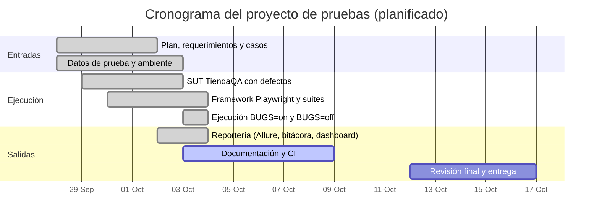

# 01 — Plan de pruebas de TiendaQA

> Universidad Mariano Gálvez de Guatemala · Aseguramiento de la Calidad del Software
> Estructura basada en **IEEE 829-2008** y en la plantilla de plan de pruebas de **ISO/IEC/IEEE 29119-3:2021** (ver bibliografía en [12](12-playwright-ventajas-limitaciones.md)).

| Campo | Valor |
|---|---|
| **Identificador del plan** | PP-TIENDAQA-001 |
| **Versión** | 1.0 (2026-10-03) |
| **Elemento bajo prueba** | TiendaQA v1.0.0 (aplicación web propia: SPA + API REST + SQLite) |
| **Herramienta de automatización** | Playwright 1.63.0 con TypeScript |
| **Artefactos relacionados** | [02 Casos](02-casos-de-prueba.md) · [03 Trazabilidad](03-requerimientos-y-trazabilidad.md) · [04 Diseño](04-modelo-de-diseno.md) · [05 Datos](05-datos-de-prueba.md) · [06 Guía](06-guia-de-pruebas.md) · [07 Ambiente](07-configuracion-ambiente.md) |

## 1. Introducción

### 1.1 Propósito
Este plan define el alcance, el enfoque, los recursos y el calendario de las pruebas de **TiendaQA**, una tienda en línea sencilla creada como aplicación bajo prueba (SUT) para mostrar las capacidades de Playwright y el proceso completo de pruebas **ENTRADAS → EJECUCIÓN → SALIDAS**.

### 1.2 Objetivos de las pruebas
1. Verificar que los **9 requerimientos funcionales** (RF-01 a RF-09) se cumplen en Chromium, Firefox, WebKit y en emulación móvil.
2. Verificar los **requerimientos no funcionales** de compatibilidad, resiliencia ante fallos de red, seguridad de acceso, usabilidad/consistencia visual y accesibilidad (RNF-01 a RNF-05).
3. Detectar los **5 defectos intencionales** sembrados en la aplicación (BUG-001 a BUG-005), documentarlos y comprobar su corrección mediante pruebas de regresión.
4. Demostrar un proceso reproducible y trazable: cada caso tiene identificador, requerimiento, evidencia, bitácora y reporte de defecto.

### 1.3 Del modelo de proceso a los archivos del repositorio

```mermaid
flowchart LR
    subgraph ENTRADAS
        A1[Plan de pruebas<br>docs/01]
        A2[Casos de prueba<br>docs/02 + CSV]
        A3[Requerimientos y<br>trazabilidad docs/03]
        A4[Modelo de diseño<br>docs/04]
        A5[Datos de prueba<br>db/*.sql + test-data/]
        A6[Guía y ambiente<br>docs/06 y docs/07]
    end
    subgraph EJECUCION
        B1[Scripts Playwright<br>tests/**/*.spec.ts]
        B2[Componentes de prueba<br>tests/pages · fixtures]
        B3[Ambiente: app TiendaQA<br>+ navegadores]
    end
    subgraph SALIDAS
        C1[Bitácora SQLite<br>reports/bitacora.db]
        C2[Informe de ejecución<br>reports/informe-ejecucion.md]
        C3[Defectos<br>reports/defectos/DEF-XXX.md]
        C4[Reportes HTML · Allure<br>JUnit · dashboard]
        C5[Solicitudes de cambio<br>docs/10 · versiones docs/11]
    end
    ENTRADAS --> EJECUCION --> SALIDAS
    SALIDAS -. retroalimentación .-> ENTRADAS
```

## 2. Referencias

- Requerimientos y matriz de trazabilidad: [03](03-requerimientos-y-trazabilidad.md).
- IEEE Std 829-2008; ISO/IEC/IEEE 29119-3:2021; ISTQB CTFL Syllabus v4.0 (términos y técnicas de diseño).
- WCAG 2.1 (nivel A y AA) como referencia de accesibilidad.
- Documentación oficial de Playwright (<https://playwright.dev/docs/intro>).

## 3. Elementos de prueba

| Elemento | Versión | Descripción |
|---|---|---|
| Frontend (SPA) | 1.0.0 | HTML/CSS/JS vanilla en `app/public/` (login, catálogo, carrito, checkout, pedidos, panel admin) |
| API REST | 1.0.0 | Express 5 en `app/routes/` (`/api/auth`, `/api/products`, `/api/cart`, `/api/orders`) documentada en `/api-docs` |
| Base de datos | — | SQLite (`better-sqlite3`), creada con `db/schema.sql` y `db/seed.sql` |
| Modos de la app | — | `BUGS=on` (5 defectos activos, por defecto) · `BUGS=off` (defectos corregidos) |

## 4. Características a probar

| ID | Característica | Tipos de prueba aplicados |
|---|---|---|
| RF-01 | Inicio de sesión (válido, inválido, usuario bloqueado) | Funcional, data-driven, API |
| RF-02 | Cierre de sesión e invalidación del token | Funcional, API |
| RF-03 | Catálogo y búsqueda (incluye tildes, ñ y caracteres especiales) | Funcional, API, mocking de red |
| RF-04 | Filtros por categoría, precio máximo y ordenamiento | Funcional, API |
| RF-05 | Carrito (agregar, cambiar cantidad, eliminar, stock) | Funcional, API, mocking de red |
| RF-06 | Cupones de descuento (porcentual, fijo, mínimo, expirado) | Funcional, data-driven, API |
| RF-07 | Checkout con formulario validado y pago | Funcional, data-driven, API, móvil |
| RF-08 | Panel de administración: CRUD de productos | Funcional, API |
| RF-09 | Historial de pedidos | Funcional |
| RNF-01 | Compatibilidad: Chromium, Firefox, WebKit y viewports móviles | Toda la suite × 6 proyectos |
| RNF-02 | Resiliencia: la UI maneja API caída, lenta o vacía | Mocking de red |
| RNF-03 | Seguridad de acceso: autenticación y autorización por rol | Funcional, API |
| RNF-04 | Usabilidad responsive y consistencia visual | Móvil, regresión visual |
| RNF-05 | Accesibilidad WCAG 2.1 A/AA | axe-core |

El detalle de cada requerimiento y su criterio de aceptación está en [03](03-requerimientos-y-trazabilidad.md).

## 5. Características que no se probarán (fuera de alcance)

| Aspecto | Motivo |
|---|---|
| Rendimiento y carga | El proyecto usa una BD local de un solo proceso; no hay objetivos de carga definidos |
| Pruebas de penetración / seguridad avanzada | Fuera del alcance del curso; solo se verifica autenticación y autorización básica (RNF-03) |
| Pasarela de pago real | El pago es simulado: la tarjeta terminada en `0002` se rechaza y cualquier otra válida se aprueba |
| Dispositivos físicos y Safari/Chrome de marca | Playwright emula móviles y usa sus propios builds de navegador (ver [12](12-playwright-ventajas-limitaciones.md)) |
| Envío de correos, internacionalización, recuperación de contraseña | La aplicación no implementa estas funciones |
| Accesibilidad manual (lector de pantalla, teclado completo) | axe-core solo detecta una parte de los problemas; se documenta como limitación |

## 6. Enfoque de pruebas

### 6.1 Niveles y tipos de prueba

| Tipo | Qué valida | Herramienta / técnica | Etiqueta |
|---|---|---|---|
| **Funcional (E2E)** | Flujos de usuario completos en la UI | Playwright + Page Object Model | `@smoke` `@regression` |
| **Data-driven** | Mismo flujo con muchos datos (positivos, negativos y valores límite) | JSON y CSV en `test-data/` | `@regression` |
| **Regresión** | Que lo corregido siga funcionando: toda la suite con `BUGS=off` | Suite completa | `@regression` |
| **API** | Contratos, códigos HTTP, autenticación y encadenado API + UI | `request` de Playwright | `@api` |
| **Resiliencia de red** | Comportamiento de la UI ante 500, respuesta lenta, vacío, 401, 409 | `page.route` (mocking) | — |
| **Regresión visual** | Cambios no intencionales en la apariencia | `toHaveScreenshot` (línea base con `BUGS=off`) | `@visual` |
| **Accesibilidad** | Violaciones WCAG 2.1 A/AA | `@axe-core/playwright` | `@a11y` |
| **Móvil / responsive** | Menú hamburguesa y checkout en viewport móvil | Emulación Pixel 7 e iPhone 14 | `@mobile` |
| **Aceptación** | El sistema cumple los criterios de aceptación de cada RF | Subconjunto `@smoke` (10 ejecuciones) + validación manual guiada | `@smoke` |

### 6.2 Técnicas de diseño de casos
- **Partición de equivalencia:** clases válidas e inválidas de correo, contraseña, cantidades y tarjeta.
- **Análisis de valores límite:** teléfono de 7/8/9 dígitos, tarjeta de 15/16/17, CVV de 2/3/4, dirección de 4 y 5 caracteres, umbral de Q500 en cupones.
- **Tablas de decisión:** reglas de cupones (tipo, mínimo, vigencia).
- **Adivinanza de errores:** caracteres especiales en búsqueda (`ñ`, tildes, comilla simple), inyección SQL en el correo.
- **Pruebas basadas en riesgo:** prioridad Alta para pagos, autenticación y carrito.

### 6.3 Estrategia de automatización
1. **Independencia:** cada prueba crea su propio cliente por API (fixture `clienteNuevo`), por lo que se puede ejecutar en paralelo y en cualquier orden.
2. **Cero esperas fijas:** auto-waiting y aserciones web-first; ESLint prohíbe `waitForTimeout`.
3. **Selectores robustos:** por rol, etiqueta o `data-testid`; nunca XPath ni clases CSS frágiles.
4. **Datos controlados:** la base se reinicia con `db/schema.sql` + `db/seed.sql` al iniciar cada corrida.
5. **Evidencia automática:** captura y video al fallar, traza en el primer reintento, bitácora y reporte de defecto.

### 6.4 Matriz de ejecución

| Proyecto | Motor | Suites que ejecuta |
|---|---|---|
| `api` | — | `tests/api/` (sin navegador) |
| `chromium` | Chromium | E2E, data-driven, red, visual, accesibilidad, defectos |
| `firefox` | Firefox | Igual que Chromium, excepto visual |
| `webkit` | WebKit | Igual que Chromium, excepto visual |
| `mobile-pixel7` | Chromium (emulado) | `tests/mobile/` |
| `mobile-iphone14` | WebKit (emulado) | `tests/mobile/` |

Total: **25 casos de prueba** únicos que dan **59 ejecuciones** ([02](02-casos-de-prueba.md)).

## 7. Criterios

### 7.1 Criterios de entrada
- Ambiente instalado según [07](07-configuracion-ambiente.md): Node.js 22+, dependencias y los tres navegadores de Playwright.
- La aplicación inicia (`/api/health` responde `ok`) y la base de datos se reinicia correctamente.
- Plan, requerimientos y casos de prueba aprobados y versionados.
- `npm run typecheck` y `npm run lint` sin errores.

### 7.2 Criterios de salida (se evalúan automáticamente en `informe-ejecucion.md`)
- **100 %** de las pruebas `@smoke` exitosas.
- Tasa de éxito global **≥ 95 %**; en la corrida de regresión final con `BUGS=off` se espera **100 %**.
- **0 defectos** de severidad crítica o bloqueante abiertos.
- Todos los defectos encontrados tienen reporte `DEF-XXX` y están corregidos y verificados, o diferidos con aprobación.

### 7.3 Criterios de aprobación o fallo de un caso
Un caso **pasa** cuando todas sus aserciones se cumplen sin error; **falla** si alguna aserción no se cumple o expira el tiempo; es **inestable (flaky)** si falla y pasa al reintentarse (se investiga y se corrige, no se tolera).

### 7.4 Criterios de suspensión y reanudación
| Se suspende la ejecución cuando… | Se reanuda cuando… |
|---|---|
| La aplicación no inicia o `/api/health` no responde | Se corrige el arranque y se reinicia la BD |
| Más del 30 % de las pruebas `@smoke` fallan (defecto bloqueante) | Se corrige y las `@smoke` pasan |
| Fallo del ambiente (navegadores sin instalar, puerto ocupado, BD corrupta) | Se restablece el ambiente y se ejecuta `npm run db:reset` |
| La línea base visual no corresponde al sistema operativo | Se regenera con `npm run test:visual:update` (con `BUGS=off`) |

## 8. Entregables

| Entregable | Ubicación |
|---|---|
| Plan, casos, trazabilidad, diseño, datos, guía y ambiente | `docs/01` a `docs/07` |
| Scripts de prueba y componentes | `tests/` |
| Datos de prueba | `db/schema.sql`, `db/seed.sql`, `test-data/` |
| Bitácora de ejecución | `reports/bitacora.db` |
| Informe de ejecución | `reports/informe-ejecucion.md` |
| Reportes de defecto | `reports/defectos/DEF-XXX.md` |
| Reportes HTML, Allure, JUnit y JSON | `playwright-report/`, `allure-report/`, `reports/junit.xml`, `reports/resultados.json` |
| Dashboard | `reports/dashboard/index.html` |
| Solicitudes de cambio y registro de versiones | `docs/10`, `docs/11` |

## 9. Tareas de prueba

1. Diseñar los casos a partir de los requerimientos y asignarles ID.
2. Preparar datos de prueba y el ambiente.
3. Implementar los componentes (Page Objects, fixtures) y los scripts.
4. Ejecutar con `BUGS=on`, registrar la bitácora y generar los reportes de defecto.
5. Corregir (`BUGS=off`) y ejecutar la regresión completa.
6. Analizar resultados, evaluar criterios de salida y registrar solicitudes de cambio.
7. Actualizar y versionar los documentos.

## 10. Necesidades de ambiente
Resumen (el detalle está en [07](07-configuracion-ambiente.md)): Node.js 22 o superior, Chromium, Firefox y WebKit de Playwright 1.63.0, SQLite embebido, 4 GB de RAM como mínimo y unos 2 GB de disco para los navegadores. Alternativa: contenedor Docker con la imagen oficial de Playwright.

## 11. Responsabilidades y dotación

| Rol | Responsabilidad |
|---|---|
| Líder de QA | Plan de pruebas, criterios de salida, aprobación de entregables |
| Analista de pruebas | Diseño de casos, datos de prueba, trazabilidad |
| Automatizador (SDET) | Page Objects, fixtures, scripts, integración continua |
| Desarrollador del SUT | Corrección de defectos y atención de solicitudes de cambio |
| Docente / revisor | Revisión y aprobación académica |

Capacitación requerida: TypeScript básico, conceptos de Playwright (locators, auto-waiting, fixtures) y lectura de reportes; ver [06](06-guia-de-pruebas.md).

## 12. Cronograma

Estado al 2026-10-03: SUT, framework, suites y reportería completados; documentación y CI en curso.

## 13. Riesgos y contingencias

| # | Riesgo | Prob. | Impacto | Contingencia |
|---|---|---|---|---|
| R1 | Falla un navegador o falta una dependencia del sistema (p. ej. WebKit en Linux) | Media | Alto | Instalar con `npx playwright install --with-deps`; usar Docker; en caso necesario ejecutar solo Chromium |
| R2 | Líneas base visuales distintas entre sistemas operativos o fuentes | Alta | Medio | Generar la línea base en el ambiente de ejecución (`npm run test:visual:update`); ejecutar `@visual` en un solo ambiente |
| R3 | Pruebas inestables por datos compartidos | Media | Alto | Un cliente nuevo por prueba (fixture `clienteNuevo`) y producto único en las pruebas de admin |
| R4 | Puerto 3101 ocupado o BD bloqueada | Baja | Medio | Cambiar `TEST_PORT`; `npm run reportes:limpiar` y reiniciar |
| R5 | Falla de red (descarga de navegadores) | Media | Alto | Instalar navegadores con antelación; usar la imagen de Docker |
| R6 | Falsos positivos de accesibilidad automatizada | Media | Bajo | Revisar el JSON de axe adjunto y documentar la excepción; complementar con revisión manual |
| R7 | Los defectos intencionales se confunden con defectos reales | Baja | Bajo | Todos están catalogados (BUG-001 a BUG-005) en [09](09-hallazgo-de-defectos.md) |

## 14. Aprobaciones

| Rol | Nombre | Firma | Fecha |
|---|---|---|---|
| Líder de QA | | | |
| Docente / revisor | | | |
