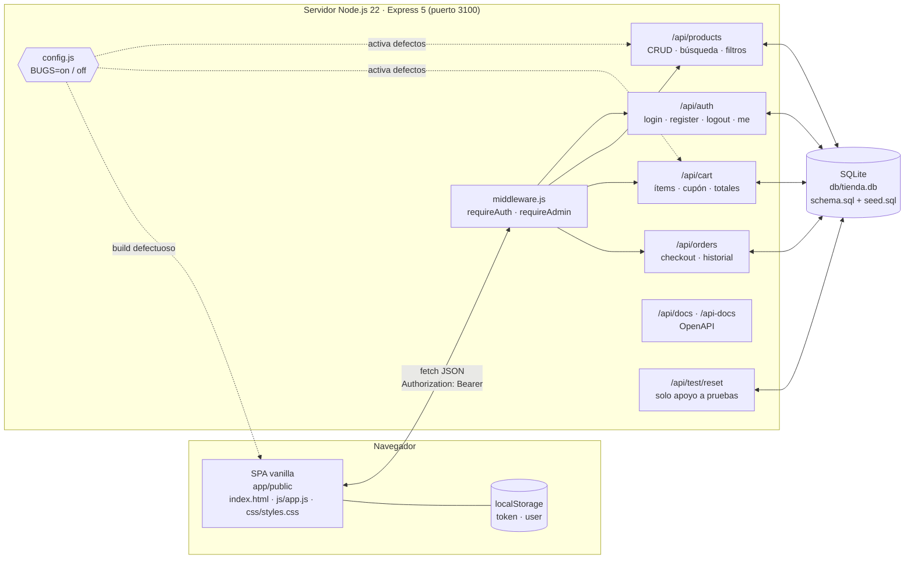
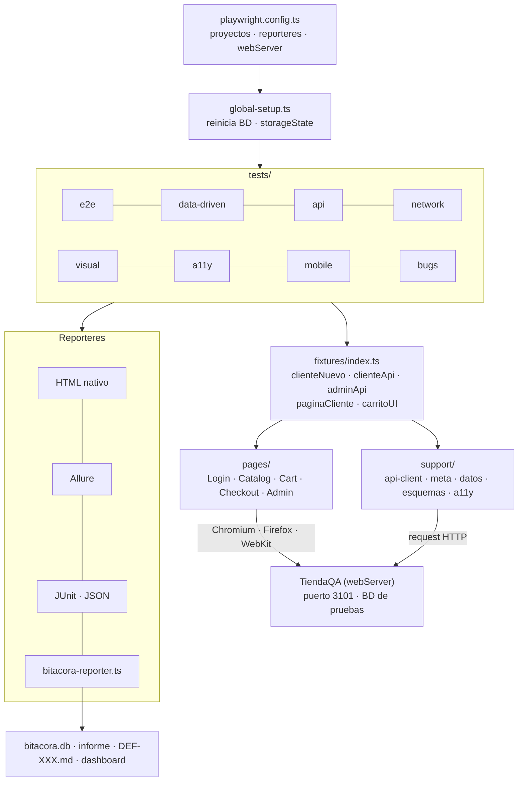
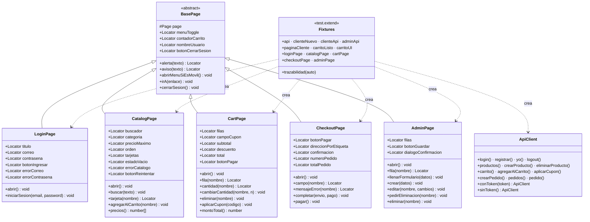
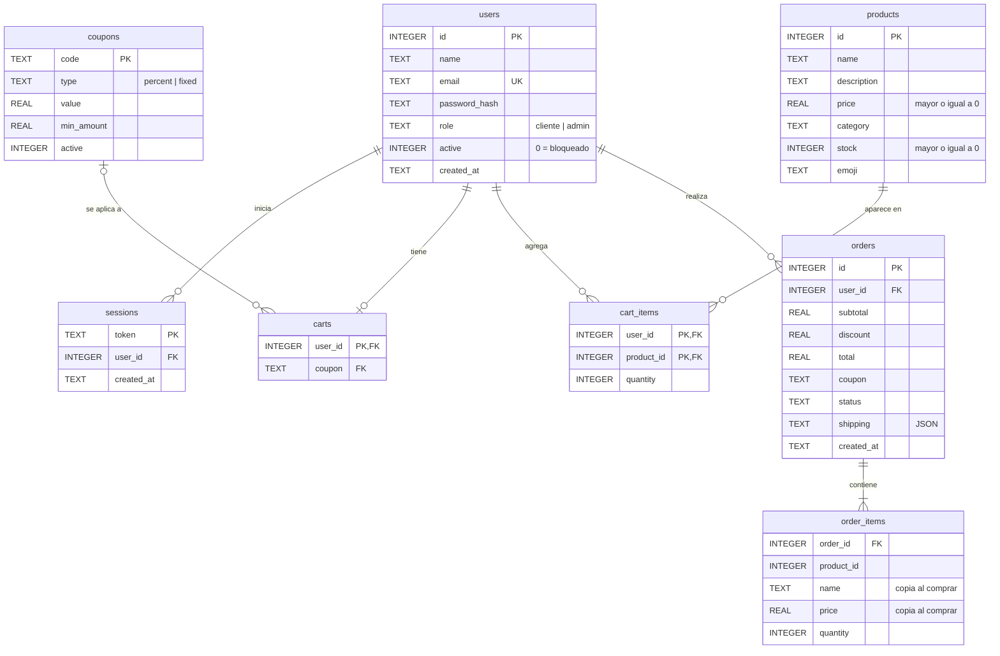
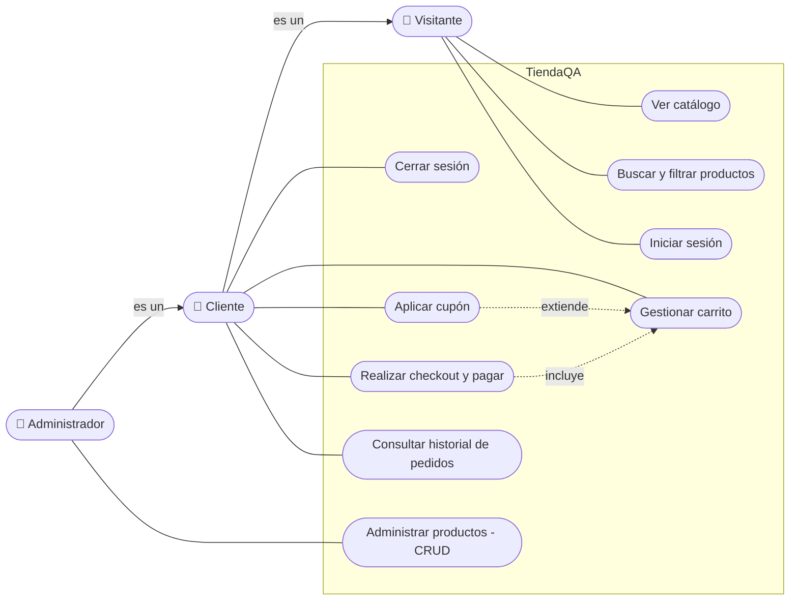
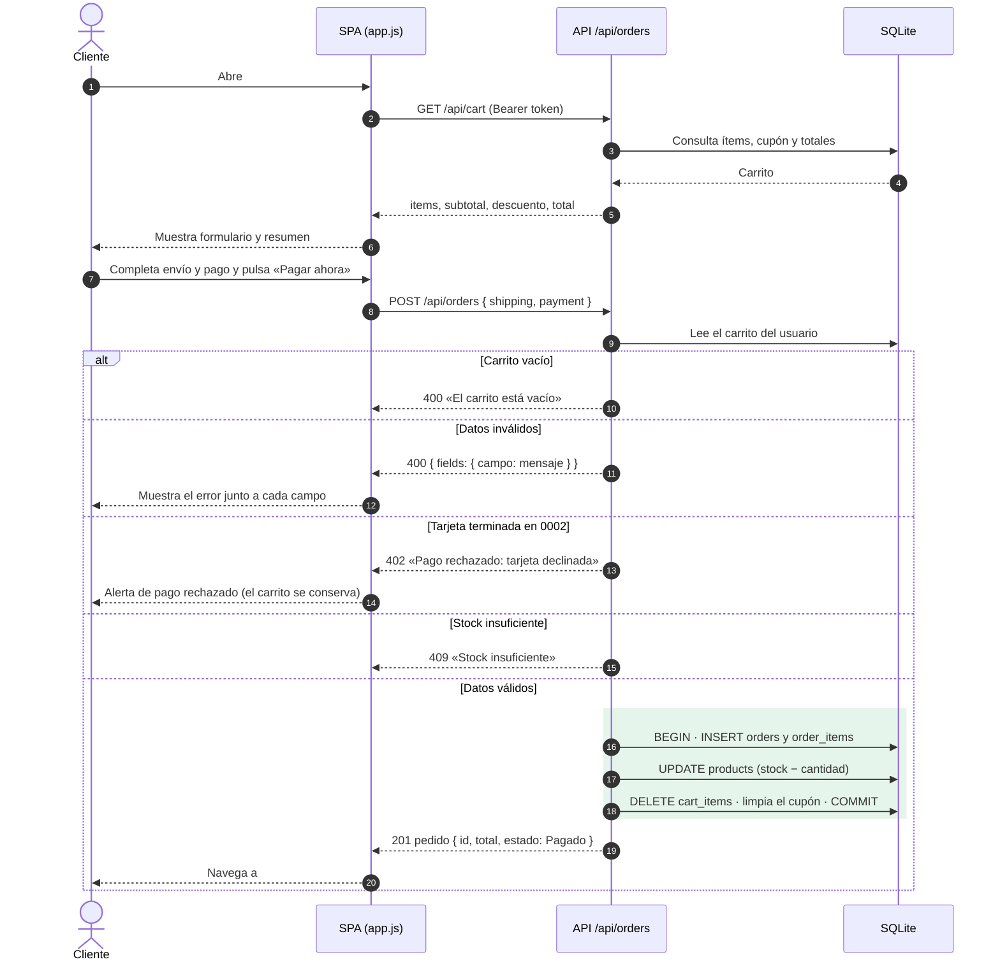

# 04 — Modelo de diseño

> Entrada del proceso de pruebas: describe cómo está construida la aplicación bajo prueba (TiendaQA) y el framework de pruebas. Los diagramas están en **Mermaid** y se visualizan directamente en GitHub y en la mayoría de editores de Markdown.

## 1. Arquitectura de la aplicación (SUT)

TiendaQA es una aplicación de tres capas ejecutada en un solo proceso Node.js.

| Capa | Tecnología | Responsabilidad |
|---|---|---|
| Presentación | HTML/CSS/JS vanilla, rutas por hash (`#/catalogo`, `#/carrito`, `#/checkout`…) | Render de vistas, validación de formularios, manejo de errores de red |
| Lógica / API | Express 5 | Reglas de negocio (cupones, stock, pedidos), autenticación por token y roles |
| Datos | SQLite con `better-sqlite3` | Persistencia; se reinicia con scripts SQL |

Los defectos intencionales viven en: `app/routes/cart.js` (BUG-001 y BUG-002), `app/routes/products.js` (BUG-003) y `app/public/js/app.js` + `styles.css` (BUG-004 y BUG-005). Todos dependen de la variable `BUGS`.

## 2. Arquitectura del framework de pruebas

## 3. Diagrama de clases del Page Object Model

Los Page Objects son los **componentes de prueba**: encapsulan los locators y las acciones de cada pantalla para que los tests lean como pasos de negocio.

## 4. Modelo entidad-relación de la base de datos

Corresponde a `db/schema.sql`.

`order_items` guarda una copia del nombre y precio del producto al momento de la compra, de modo que el historial no cambia si el administrador edita o elimina el producto después.

## 5. Diagrama de casos de uso

| Caso de uso | Requerimiento | Casos de prueba principales |
|---|---|---|
| Ver catálogo / Buscar y filtrar | RF-03, RF-04 | CP-E2E-003, CP-API-002, CP-DEF-003 |
| Iniciar / cerrar sesión | RF-01, RF-02 | CP-E2E-002, CP-DD-001, CP-API-001 |
| Gestionar carrito | RF-05 | CP-E2E-004, CP-API-004, CP-DEF-002 |
| Aplicar cupón | RF-06 | CP-E2E-004, CP-DD-003, CP-DEF-001 |
| Realizar checkout y pagar | RF-07 | CP-E2E-001, CP-E2E-005, CP-DD-002, CP-API-005, CP-MOV-002 |
| Consultar historial | RF-09 | CP-E2E-007 |
| Administrar productos | RF-08 | CP-E2E-006, CP-API-003, CP-INT-001 |

## 6. Diagrama de secuencia del checkout

Incluye los caminos alternos que cubren los casos CP-E2E-005 (validaciones y tarjeta declinada) y CP-API-005.

## 7. API REST (resumen)

| Método y ruta | Auth | Descripción | Códigos |
|---|---|---|---|
| `POST /api/auth/login` | — | Inicia sesión | 200, 400, 401, 403 |
| `POST /api/auth/register` | — | Registra un cliente | 201, 400, 409 |
| `POST /api/auth/logout` · `GET /api/auth/me` | Token | Cierra sesión · usuario actual | 204 · 200, 401 |
| `GET /api/products` | — | Lista con `q`, `category`, `minPrice`, `maxPrice`, `sort` | 200 (500 con BUG-003) |
| `GET /api/products/:id` | — | Detalle | 200, 404 |
| `POST · PUT · DELETE /api/products` | Admin | CRUD de productos | 201/200/204, 400, 401, 403, 404 |
| `GET /api/cart` | Token | Carrito con totales | 200, 401 |
| `POST · PATCH · DELETE /api/cart/items` | Token | Agregar, cambiar cantidad, quitar | 201/200, 400, 404, 409 |
| `POST · DELETE /api/cart/coupon` | Token | Aplicar o quitar cupón | 200, 400, 404 |
| `POST /api/orders` | Token | Checkout | 201, 400, 402, 409 |
| `GET /api/orders` · `GET /api/orders/:id` | Token | Historial (admin: `?all=1`) · detalle | 200, 404 |
| `GET /api/health` | — | Estado y modo de bugs | 200 |
| `POST /api/test/reset` | — | Reinicia la BD (solo apoyo a pruebas) | 200 |

La especificación completa se sirve en `/api/docs` (OpenAPI 3) y se ve en `/api-docs`.
