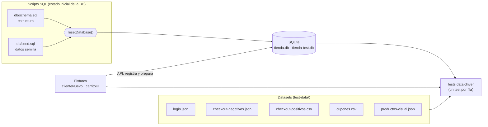

# 05 — Datos de prueba

> Entrada del proceso de pruebas. Describe los conjuntos de datos, los scripts SQL, los archivos JSON/CSV, las precondiciones y cómo reiniciarlos.

## 1. Visión general

Hay tres tipos de datos:
1. **Datos persistentes del sistema** (usuarios, productos, cupones): los crea `db/seed.sql`.
2. **Datos por prueba** (cliente, carrito, pedidos): los crean las fixtures por API en cada test.
3. **Datos de entrada de las pruebas dirigidas por datos**: archivos JSON/CSV en `test-data/`.

## 2. Scripts SQL

| Archivo | Contenido |
|---|---|
| `db/schema.sql` | `DROP TABLE IF EXISTS` + `CREATE TABLE` de las 8 tablas (`users`, `sessions`, `products`, `coupons`, `carts`, `cart_items`, `orders`, `order_items`), restricciones `CHECK` e índices. Ver el modelo ER en [04](04-modelo-de-diseno.md). |
| `db/seed.sql` | `INSERT` de 4 usuarios, 12 productos y 4 cupones. |

Como el esquema empieza con `DROP TABLE IF EXISTS`, ejecutar ambos scripts siempre deja la base en un estado conocido.

### 2.1 Usuarios semilla
Contraseña almacenada como `sha256('tiendaqa:' + contraseña)`.

| Correo | Contraseña | Rol | Activo | Uso en las pruebas |
|---|---|---|---|---|
| `admin@tiendaqa.com` | `Admin123!` | admin | Sí | Panel de administración, CRUD, API de administración |
| `ana@tiendaqa.com` | `Cliente123!` | cliente | Sí | `storageState` de cliente (casos con sesión ya iniciada) y login de los recorridos visuales |
| `luis@tiendaqa.com` | `Cliente123!` | cliente | Sí | Login con correo en mayúsculas (fila `CP-DD-LOGIN-002` de `CP-DD-001`) |
| `bloqueado@tiendaqa.com` | `Cliente123!` | cliente | **No** | Usuario bloqueado (`CP-E2E-002`, `CP-API-001`) |

### 2.2 Productos semilla

| ID | Producto | Categoría | Precio (Q) | Stock | Notas de uso |
|---|---|---|---|---|---|
| 1 | Café de Antigua 500g | Alimentos | 75.00 | 200 | Búsqueda con tilde (BUG-003) |
| 2 | Teclado Mecánico | Tecnología | 450.00 | 150 | Detalle por API (`CP-API-002`); umbral bajo Q500 |
| 3 | Mouse Inalámbrico | Tecnología | 120.00 | 300 | Búsqueda y cupón en API |
| 4 | Audífonos Bluetooth | Tecnología | 380.00 | 120 | 2 unidades = Q760 (BUG-001) |
| 5 | Cuaderno Universitario | Papelería | 25.00 | 500 | Producto del carrito en la mayoría de las pruebas |
| 6 | Set de Bolígrafos | Papelería | 30.00 | 400 | Filtro por categoría |
| 7 | Mochila Ñandú | Accesorios | 260.00 | 100 | Búsqueda con `ñ` (BUG-003) |
| 8 | Botella Térmica 1L | Accesorios | 150.00 | 180 | Pedido por API y cupón FIJO50 |
| 9 | Cacao Artesanal | Alimentos | 55.00 | 250 | — |
| 10 | Monitor 24 pulgadas | Tecnología | 1500.00 | 40 | Compra grande (BUG-001); stock límite en API |
| 11 | Pantalón D'Lujo | Ropa | 199.00 | 90 | Búsqueda con comilla simple (BUG-003) |
| 12 | Camisa Guatemalteca | Ropa | 180.00 | 60 | — |

### 2.3 Cupones semilla

| Código | Tipo | Valor | Compra mínima | Activo | Comportamiento esperado |
|---|---|---|---|---|---|
| `BIENVENIDO10` | porcentual | 10 % | — | Sí | Descuento = 10 % del subtotal (con BUG-001, 20 % desde Q500) |
| `VERANO20` | porcentual | 20 % | — | Sí | Descuento = 20 % del subtotal (con BUG-001, 40 % desde Q500) |
| `FIJO50` | fijo | Q50 | Q200 | Sí | Q50 si el subtotal ≥ Q200; si no, error 400 |
| `EXPIRADO5` | porcentual | 5 % | — | **No** | Siempre rechazado (404) |

### 2.4 Tarjetas y datos de pago simulados

| Dato | Valor | Resultado |
|---|---|---|
| Tarjeta válida | `4111111111111111` o `5500000000000004` | Pago aprobado |
| Tarjeta declinada | termina en `0002` (p. ej. `4000000000000002`) | HTTP 402 «Pago rechazado: tarjeta declinada» |
| Vencimiento válido | `12/35`, `06/40` | Aceptado |
| Vencimiento vencido | `01/20` | «La tarjeta está vencida» |
| CVV válido | 3 dígitos | Aceptado |

> El vencimiento `12/35` deja de ser válido a partir de enero de 2036; en ese caso hay que actualizar `PAGO_VALIDO` en `tests/fixtures/index.ts` y los datasets.

## 3. Archivos de datos (`test-data/`)

| Archivo | Formato | Filas | Lo consume | Contenido |
|---|---|---|---|---|
| `login.json` | JSON | 8 | `tests/data-driven/datos.dd.spec.ts` (`CP-DD-001`) | Casos de login: positivos (3), negativos (4) y límite (1). Campos: `id`, `tipo`, `descripcion`, `email`, `password`, `esperado` (`catalogo`, `admin`, `error`, `validacion`), `mensaje`. |
| `checkout-negativos.json` | JSON | 8 | `tests/data-driven/datos.dd.spec.ts` (`CP-DD-002`) | Un campo inválido por fila con su mensaje esperado. Incluye valores límite: teléfono de 7 dígitos, tarjeta de 15, CVV de 2 y dirección de 4 caracteres, además de correo inválido, tarjeta vencida y formato de vencimiento. |
| `checkout-positivos.csv` | CSV | 3 | `tests/data-driven/datos.dd.spec.ts` (`CP-DD-002`) | Compras válidas: datos típicos, dirección de exactamente 5 caracteres y nombre con tildes y ñ. |
| `cupones.csv` | CSV | 6 | `tests/data-driven/datos.dd.spec.ts` (`CP-DD-003`) | Producto, cantidad, cupón y subtotal, descuento y total esperados; la columna `defecto_asociado` enlaza con BUG-001 en los montos de Q500 o más. |
| `productos-visual.json` | JSON | 4 | `tests/visual/visual.spec.ts` | Productos congelados que se inyectan con `page.route` para que la captura del catálogo sea determinista. |
| `casos-detalle.json` | JSON | 25 | `scripts/generar-docs.ts` | Precondiciones, datos, pasos y resultado esperado de cada caso (fuente de [02](02-casos-de-prueba.md)). |
| `defectos-catalogo.json` | JSON | 5 | `tests/reporters/defectos.ts` | Título, severidad, pasos y resultado esperado/obtenido de BUG-001 a BUG-005 (fuente de los reportes `DEF-XXX.md`). |

Las filas se leen con `leerJson()` y `leerCsv()` (`tests/support/datos.ts`) y cada dataset alimenta **un solo caso** (`CP-DD-001`, `CP-DD-002` y `CP-DD-003`) y **cada fila se ejecuta como un paso** (`test.step`): si una fila falla, el caso continúa con las demás y al final reporta **todas** las filas que fallaron.

## 4. Precondiciones

| Para… | Precondición |
|---|---|
| Cualquier corrida | La base de datos está en estado semilla (la deja así `global-setup.ts`) |
| Pruebas de UI autenticadas | Existe un cliente nuevo con token (fixture `clienteNuevo` → `paginaCliente`) |
| Pruebas de carrito, checkout y cupones | El cliente tiene `2 × Cuaderno Universitario` (fixture `carritoListo`/`carritoUI`) o productos agregados por API |
| Pruebas de administración | Sesión de administrador (`storageState` en `.auth/admin.json`) |
| Pruebas visuales | Línea base generada con `BUGS=off` en el mismo sistema operativo (`npm run test:visual:update`) |
| Pruebas de defectos | Resultados esperados: **fallan con `BUGS=on` y pasan con `BUGS=off`** |

## 5. Aislamiento de datos entre pruebas

| Técnica | Dónde | Efecto |
|---|---|---|
| Un cliente por prueba | Fixture `clienteNuevo` (correo único: worker + marca de tiempo + aleatorio) | Carritos y pedidos nunca se mezclan; se puede paralelizar |
| Producto con nombre único | Pruebas de administración (`QA Crear <worker>-<tiempo>`) | No chocan entre sí; se eliminan al final |
| Datos congelados por mock | `CP-VIS-001` | La captura no depende de lo que hayan creado otras pruebas |
| Búsqueda de producto por nombre sin usar `q` | `productoPorNombre()` | Las pruebas de otras funciones no fallan por BUG-003 |
| Reinicio al inicio de cada corrida | `global-setup.ts` → `POST /api/test/reset` | Todas las corridas parten del mismo estado |

> Importante: **no se reinicia la base durante la ejecución**, porque borraría las sesiones de las pruebas en paralelo. Solo se reinicia al inicio.

## 6. Cómo reiniciar los datos

| Necesidad | Comando | Qué hace |
|---|---|---|
| Reiniciar la base de desarrollo (la que usa `npm run app`) | `npm run db:reset` | Borra `db/tienda.db` y la recrea con `schema.sql` + `seed.sql` |
| Reiniciar la base de pruebas | Automático al ejecutar `npm test` | `global-setup.ts` llama a `POST /api/test/reset` |
| Reiniciar la base de una app ya levantada | `curl -X POST http://localhost:3100/api/test/reset` | Reejecuta ambos scripts sin reiniciar el proceso |
| Empezar desde cero (BD + reportes) | `npm run reportes:limpiar` y luego `npm run db:reset` | Borra bitácora, informes, defectos y resultados previos |

## 7. Datos de prueba sensibles
Los datos son ficticios y de uso académico. Las contraseñas y tarjetas no corresponden a personas ni a instrumentos reales. Los archivos `.auth/` (tokens de sesión de prueba) y `db/*.db` están en `.gitignore` y no se versionan.
