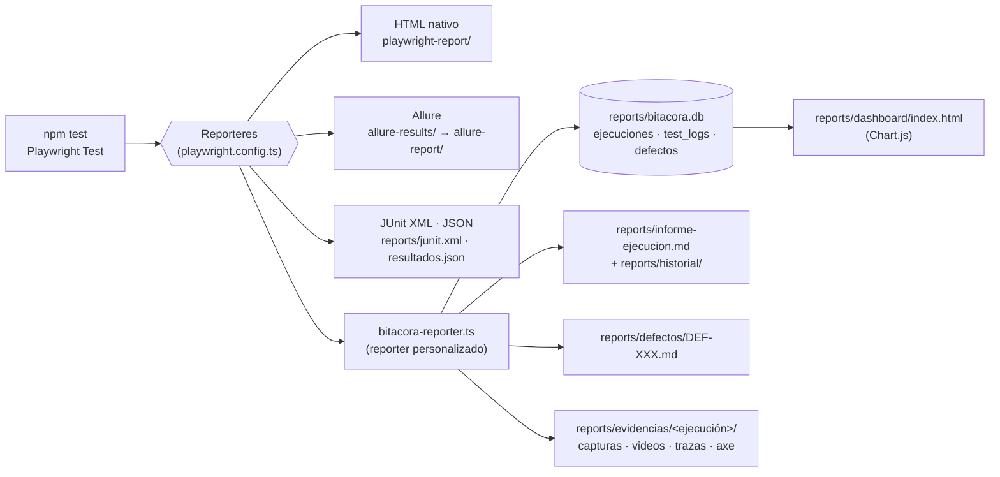

# 08 — Bitácora y reportes

> Salida del proceso de pruebas. Explica **cómo se generan** y **cómo se leen** los logs y los reportes que produce cada ejecución.

## 1. Qué produce cada ejecución



| Salida | Archivo | Formato | Para quién |
|---|---|---|---|
| Reporte HTML de Playwright | `playwright-report/index.html` | HTML | Analista: filtra por estado, ve pasos, trazas y adjuntos |
| Reporte Allure | `allure-report/index.html` | HTML | Gestión: épicas, features, severidad, requerimiento, pasos |
| JUnit y JSON | `reports/junit.xml`, `reports/resultados.json` | XML / JSON | Integración continua y otras herramientas |
| **Bitácora (log de ejecución)** | `reports/bitacora.db` | SQLite | Auditoría y consultas con SQL |
| **Informe de ejecución** | `reports/informe-ejecucion.md` (copias en `reports/historial/`) | Markdown | Entrega al docente / líder de QA |
| **Reportes de defecto** | `reports/defectos/DEF-001.md`… | Markdown | Desarrollo y seguimiento |
| Evidencias | `reports/evidencias/<id-ejecución>/<proyecto>__<caso>/` | PNG, WEBM, ZIP, JSON | Reproducir y demostrar el fallo |
| Dashboard | `reports/dashboard/index.html` | HTML autocontenido | Vista general de resultados |

> Las carpetas `reports/`, `playwright-report/`, `allure-results/` y `allure-report/` se generan en cada corrida y están en `.gitignore`.

## 2. Reporter personalizado `bitacora-reporter.ts`

Implementado en `tests/reporters/bitacora-reporter.ts` con la interfaz `Reporter` de Playwright. Al terminar la ejecución (`onEnd`):

1. **Recorre todos los tests** y toma el resultado **final** de cada uno (el del último reintento). El estado se traduce a: `Exitoso`, `Fallido`, `Inestable` (falló y pasó al reintentar) u `Omitido`.
2. **Copia las evidencias** de los fallos (captura, video, traza, JSON de axe) a `reports/evidencias/<id-ejecución>/`, porque Playwright borra `test-results/` en cada corrida.
3. **Guarda** la ejecución y sus renglones en `reports/bitacora.db`.
4. **Crea o actualiza los defectos** (`reports/defectos/`) y **cierra** los que ya no fallan.
5. **Genera** `informe-ejecucion.md` y una copia en `reports/historial/`.
6. **Regenera el dashboard**.
7. Imprime un resumen en consola, por ejemplo:
   `[bitácora] EJ-20261004-014441 (BUGS=on): 40 exitosas, 19 fallidas …`

Nunca debe romper la ejecución: si algo falla al generar los informes, lo informa en consola y las pruebas conservan su resultado.

### 2.1 Identificador de ejecución
Formato `EJ-AAAAMMDD-HHMMSS` en hora local (p. ej. `EJ-20261004-014441`). Una **ejecución** es una corrida de `playwright test`; guarda el modo `BUGS` y el **alcance**: `completa` o `parcial` (si se usó `--grep`, `--project` o una ruta de archivo).

## 3. La bitácora SQLite (`reports/bitacora.db`)

Se conserva entre corridas para formar el historial. `npm run reportes:limpiar` la borra para empezar de cero.

### 3.1 Tabla `test_logs` (un renglón por prueba ejecutada)

| Columna | Descripción | Ejemplo |
|---|---|---|
| `id` | Número consecutivo | 1 |
| **`id_ejecucion`** | Ejecución a la que pertenece | `EJ-20261004-014441` |
| `id_caso` | ID del caso (del título del test) | `CP-DEF-001` |
| **`caso`** | Título completo del test | `CP-DEF-001 Cupones porcentuales: el descuento es exacto … [detecta BUG-001]` |
| **`navegador`** | Proyecto de Playwright | `chromium`, `firefox`, `webkit`, `api`, `mobile-pixel7`… |
| **`estado`** | Resultado final | `Exitoso` · `Fallido` · `Inestable` · `Omitido` |
| **`inicio`**, **`fin`** | Fecha y hora ISO 8601 (UTC) del intento final | `2026-10-04T02:13:41.220Z` |
| `duracion_ms` | Duración en milisegundos | 1250 |
| **`error`** | Mensaje del error (primeros 2000 caracteres, sin colores) | `expect(locator).toHaveText(expected) failed …` |
| **`evidencia`** | Rutas de las evidencias copiadas, separadas por `;` | `reports/evidencias/EJ-…/chromium__CP-DEF-001/screenshot.png;…` |
| `etiquetas` | Etiquetas del test | `@regression` |
| `requerimiento`, `severidad`, `defecto` | Trazabilidad (annotations de `meta()`) | `RF-06`, `critical`, `BUG-001` |
| `intentos` | Cantidad de intentos (1 = sin reintentos) | 2 |
| `archivo` | Spec que contiene el test | `tests/bugs/defectos.spec.ts` |

### 3.2 Tabla `ejecuciones` (resumen por corrida)
`id_ejecucion`, `fecha_inicio`, `fecha_fin`, `duracion_ms`, `modo_bugs` (`on`/`off`), `alcance`, `total`, `exitosas`, `fallidas`, `inestables`, `omitidas`, `version_playwright`, `ambiente`.

### 3.3 Tabla `defectos` (ciclo de vida)
`id_def` (→ `DEF-001`), `clave` (`BUG-00X` o ID del caso), `titulo`, `severidad`, `estado` (`Abierto`/`Cerrado`), `ejecucion_detectado`, `ejecucion_cierre`, `fecha_detectado`, `fecha_cierre`, `historial`. Ver [09](09-hallazgo-de-defectos.md).

### 3.4 Cómo consultarla

```bash
npm run bitacora -- "SELECT id_ejecucion, modo_bugs, total, exitosas, fallidas FROM ejecuciones ORDER BY fecha_inicio DESC"
```

(También se puede abrir `reports/bitacora.db` con *DB Browser for SQLite* o con el cliente `sqlite3`.) Consultas útiles, probadas sobre la bitácora real:

| Pregunta | Consulta |
|---|---|
| ¿Cuáles fueron las últimas ejecuciones? | `SELECT id_ejecucion, modo_bugs, alcance, total, exitosas, fallidas, duracion_ms FROM ejecuciones ORDER BY fecha_inicio DESC` |
| ¿Cómo le fue a cada navegador en una ejecución? | `SELECT navegador, COUNT(*) AS total, SUM(estado='Exitoso') AS exitosas, SUM(estado='Fallido') AS fallidas, ROUND(100.0*SUM(estado='Exitoso')/COUNT(*),1) AS pct FROM test_logs WHERE id_ejecucion='EJ-20261004-014441' GROUP BY navegador` |
| ¿Qué casos fallaron y por qué defecto? | `SELECT id_caso, navegador, severidad, defecto FROM test_logs WHERE estado='Fallido' AND id_ejecucion='EJ-20261004-014441' ORDER BY id_caso` |
| ¿Cuáles son las pruebas más lentas? | `SELECT id_caso, navegador, duracion_ms FROM test_logs ORDER BY duracion_ms DESC LIMIT 10` |
| ¿Cómo evolucionó un caso? | `SELECT id_ejecucion, navegador, estado FROM test_logs WHERE id_caso='CP-DEF-001' AND navegador='chromium' ORDER BY inicio` |
| ¿Cuántos fallos aportó cada defecto? | `SELECT defecto, COUNT(*) AS fallos FROM test_logs WHERE estado='Fallido' AND defecto IS NOT NULL GROUP BY defecto ORDER BY fallos DESC` |
| ¿Estado de los defectos? | `SELECT id_def, clave, severidad, estado, ejecucion_detectado, ejecucion_cierre FROM defectos` |
| ¿Hay pruebas inestables? | `SELECT id_caso, navegador, intentos FROM test_logs WHERE estado='Inestable'` |

## 4. Informe de ejecución (`reports/informe-ejecucion.md`)

Contiene, en este orden:
1. **Resumen ejecutivo**: ID, modo `BUGS`, alcance, fechas, tiempo total, pruebas ejecutadas, **tasa de éxito**, versión de Playwright, ambiente y **veredicto** (aprobado / no aprobado).
2. **Totales por estado**.
3. **Resultados por navegador/proyecto** (incluye tiempo acumulado).
4. **Resultados por etiqueta** (`@smoke`, `@regression`, `@api`, `@visual`, `@a11y`, `@mobile`).
5. **Top 10 de casos más lentos**.
6. **Casos fallidos y defectos asociados**, y estado de todos los defectos.
7. **Evolución respecto a la ejecución anterior** (la comparación `BUGS=on` → `BUGS=off`).
8. **Criterios de salida evaluados**: smoke al 100 %, tasa ≥ 95 %, 0 críticos abiertos (ver [01](01-plan-de-pruebas.md) §7.2).
9. Enlaces a los demás artefactos.

El informe refleja **la última ejecución**; cada corrida deja además su copia en `reports/historial/informe-<id>.md`.

## 5. Reportes de defecto (`reports/defectos/DEF-XXX.md`)
Se genera uno por **causa raíz** (no uno por cada prueba fallida) con ID, título, severidad, caso(s) relacionados, pasos, esperado vs. obtenido, navegador, evidencia y estado. Su contenido, ciclo de vida y resumen de hallazgos están en [09](09-hallazgo-de-defectos.md).

## 6. Reporte HTML nativo de Playwright

```bash
npm run report            # abre playwright-report/index.html
```
Permite filtrar por proyecto y estado, ver el detalle de cada paso y abrir el **Trace Viewer** de los fallos reintentados (captura de DOM por acción, red y consola). Una traza también se abre con `npx playwright show-trace <ruta>/trace.zip`.

## 7. Reporte Allure

```bash
npm run report:allure           # genera allure-report/ y lo abre en el navegador
npm run report:allure:generar   # solo genera (sin abrir)
```

- Se usa **Allure 3** (paquete npm `allure`), que **no requiere Java**. Allure 2 sí lo necesitaba; si tu equipo prefiere esa versión, instala un JDK 8+ y la herramienta `allure-commandline`.
- Cada test publica sus metadatos: **épica** y **feature** (agrupación), **severidad**, **etiquetas**, **requerimiento** (etiqueta `requerimiento`) y **defecto**. Los pasos, capturas, videos y trazas aparecen como adjuntos.
- Los resultados (`allure-results/`) se limpian al inicio de cada corrida, por lo que el reporte siempre corresponde a la última ejecución.

## 8. Dashboard (`reports/dashboard/index.html`)

```bash
npm run dashboard      # regenera el HTML desde la bitácora (también se regenera solo en cada corrida)
```
Es un único archivo **autocontenido**: incluye Chart.js y los datos de la bitácora, y funciona abriéndolo directamente en el navegador, sin servidor. Contiene:

| Sección | Qué muestra |
|---|---|
| Ejecución seleccionada | KPIs (pruebas, exitosas, fallidas, tasa, duración, modo) con variación respecto a la anterior |
| **Evolución BUGS=on → BUGS=off** | Tabla comparativa y gráfica de tasa de éxito por navegador de la última corrida con defectos y la última sin defectos |
| Historial de ejecuciones | Barras apiladas por estado y línea de tasa de éxito y duración |
| Por navegador | Aprobadas/fallidas y duración promedio |
| Fallos por defecto | Cuántas ejecuciones fallidas aportó cada defecto |
| Tablas | Defectos (con estado), casos fallidos y el historial completo |

Un selector permite revisar cualquier ejecución anterior.

## 9. Cómo leer un fallo (de la bitácora a la causa)

1. En el **informe** o el **dashboard**, identifica el caso fallido y su defecto (`DEF-XXX`).
2. Abre el **reporte de defecto** para ver los pasos para reproducir y el esperado vs. obtenido.
3. Revisa la **captura** y el **video** en `reports/evidencias/…`.
4. Abre la **traza** (`npx playwright show-trace …`) para recorrer la ejecución acción por acción, con el DOM, la red y la consola.
5. Para el contexto histórico, consulta la **bitácora** con SQL (¿desde cuándo falla? ¿en qué navegadores?).
6. Corrige, ejecuta de nuevo y comprueba que el defecto pasa a **Cerrado**.

## 10. Reportes en integración continua
El flujo de GitHub Actions (`.github/workflows/playwright.yml`) publica como artefactos el reporte HTML, Allure, las trazas y la carpeta `reports/` (bitácora, informe, defectos y dashboard) de cada navegador. Cada trabajo de la matriz genera su propia bitácora.
