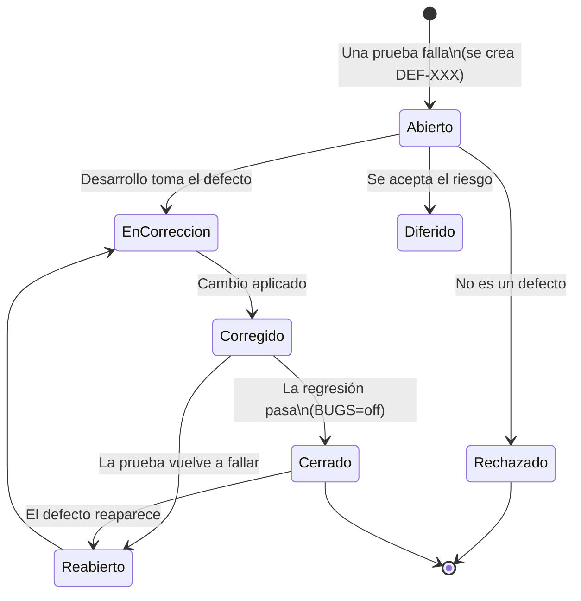

# 09 — Hallazgo de defectos

> Salida del proceso de pruebas. Describe el ciclo de vida del defecto y resume los defectos encontrados en TiendaQA.

## 1. Ciclo de vida del defecto



| Estado | Quién lo asigna | Descripción |
|---|---|---|
| **Abierto** | Automático (reporter) | Una prueba falló. Se crea o actualiza `reports/defectos/DEF-XXX.md` con evidencia |
| En corrección | Manual | Un desarrollador atiende el defecto |
| Corregido | Manual | Se aplicó el cambio y está listo para verificarse |
| **Cerrado** | Automático (reporter) | Los casos relacionados se ejecutaron y **todos pasan**; se registra la ejecución de cierre |
| **Reabierto** | Automático (reporter) | Un defecto cerrado vuelve a fallar |
| Rechazado / Diferido | Manual | No es defecto o se acepta el riesgo; se documenta en [10](10-solicitud-de-cambios.md) |

El reporter automatiza lo que se puede inferir de los resultados (abrir, mantener abierto, cerrar y reabrir). Las demás transiciones son decisiones humanas y se anotan en el historial del reporte.

> **Regla de cierre:** un defecto se cierra solo si **sus casos relacionados corrieron** en esa ejecución y todos pasaron. Si una corrida parcial no incluye esos casos, el defecto sigue abierto.

## 2. Clasificación

### 2.1 Severidad (impacto técnico y de negocio)

| Severidad | Criterio | Ejemplo en TiendaQA |
|---|---|---|
| Bloqueante | Impide usar una función central sin alternativa | (ninguno encontrado) |
| **Crítica** | Resultado incorrecto con impacto económico o de datos, o error del servidor | Descuento doble, cantidades negativas, búsqueda con error 500 |
| **Media** | Afecta a un grupo de usuarios o incumple un estándar, con alternativa | Campo sin etiqueta accesible |
| **Baja** | Cosmético o de consistencia | Botón con apariencia distinta |

### 2.2 Prioridad (urgencia de la corrección): Alta, Media, Baja. La define el líder de QA con el responsable del producto.

## 3. Contenido del reporte de defecto

Cada `DEF-XXX.md` incluye: **ID**, **título**, **severidad**, prioridad, componente, **requerimiento afectado**, **caso(s) de prueba relacionados**, **pasos para reproducir**, **resultado esperado vs. obtenido**, **navegador(es)**, **evidencia** (captura, video, traza, JSON de axe), mensaje de error, **estado** («Abierto» al crearse) e historial. Ejemplo de la cabecera:

| Campo | Valor |
|---|---|
| ID | DEF-001 |
| Defecto de referencia | BUG-001 |
| Estado | **Abierto** |
| Severidad | Crítica |
| Requerimiento afectado | RF-06 |
| Navegador(es) | api, chromium, firefox, webkit |

El detalle de cómo se generan está en [08](08-bitacora-y-reportes.md) §5.

## 4. Resumen de los defectos encontrados

Corrida de referencia (2026-10-04, suite completa, todos los proyectos):

| Ejecución | Modo | Resultado |
|---|---|---|
| `EJ-20261004-014441` | `BUGS=on` | 40 exitosas · **19 fallidas** de 59 (32.2 %) → 5 defectos abiertos |
| `EJ-20261004-014634` | `BUGS=off` | **59 exitosas** · 0 fallidas → los 5 defectos **cerrados** |

| ID | Defecto | Título | Severidad | Req. | Fallos en la corrida con `BUGS=on` | Estado final |
|---|---|---|---|---|---|---|
| DEF-001 | BUG-001 | El cupón porcentual aplica el descuento doble en compras de Q500 o más | Crítica | RF-06 | 6 | Cerrado |
| DEF-002 | BUG-002 | El carrito acepta cantidades negativas o cero | Crítica | RF-05 | 3 | Cerrado |
| DEF-003 | BUG-003 | La búsqueda con ñ, tildes o comilla simple devuelve error 500 | Crítica | RF-03 | 3 | Cerrado |
| DEF-004 | BUG-004 | El campo «Dirección de entrega» no tiene etiqueta (`<label>`) | Media | RNF-05 | 6 | Cerrado |
| DEF-005 | BUG-005 | El botón «Pagar ahora» cambió de aspecto respecto a la línea base | Baja | RNF-04 | 1 | Cerrado |
| | | | | **Total** | **19** | |

> Los números DEF se asignan en el orden en que se detectan (ordenados por defecto de referencia). Si se reinicia la bitácora, vuelven a numerarse desde `DEF-001`.

### 4.1 Casos que detectan cada defecto

<!-- DEFECTOS-CASOS:INICIO -->
| Defecto | Casos que lo detectan | Tipo de detección |
|---|---|---|
| **BUG-001** | CP-DD-003, CP-DEF-001 | Funcional (data-driven), Detección de defecto |
| **BUG-002** | CP-DEF-002 | Detección de defecto |
| **BUG-003** | CP-DEF-003 | Detección de defecto |
| **BUG-004** | CP-A11Y-001, CP-DEF-004 | Accesibilidad, Detección de defecto |
| **BUG-005** | CP-VIS-001 | Regresión visual |
<!-- DEFECTOS-CASOS:FIN -->

Un mismo defecto se detecta por **varias vías** de forma deliberada (UI, API, datos y regresión visual o accesibilidad). Es una de las ventajas de combinar tipos de prueba: BUG-003 se ve igual de bien desde la API (`500`) que desde la pantalla («No pudimos cargar el catálogo»).

### 4.2 Detalle técnico de cada defecto

| Defecto | Dónde está el código | Causa | Corrección (`BUGS=off`) |
|---|---|---|---|
| **BUG-001** | `app/routes/cart.js`, `calcDiscountCents()` | Con `BUGS=on` y subtotal ≥ Q500, el porcentaje se multiplica por 2 | Usar siempre el porcentaje del cupón. Con Q760 y `BIENVENIDO10`: esperado -Q76.00, obtenido -Q152.00 |
| **BUG-002** | `app/routes/cart.js`, `validQuantity()` | Con `BUGS=on` no se valida la cantidad | Exigir entero entre 1 y 99; responder 400 con «La cantidad debe ser un entero entre 1 y 99» |
| **BUG-003** | `app/routes/products.js`, `GET /` | Con `BUGS=on`, un `q` con caracteres no ASCII o `'` provoca 500 (simula SQL armado por concatenación) | Búsqueda normalizada (sin tildes ni mayúsculas) y sin concatenar SQL |
| **BUG-004** | `app/public/js/app.js`, `fieldHtml()` | Con `BUGS=on`, la «Dirección» se dibuja con un `<span>` en lugar de `<label for>` | Usar `<label for="direccion">`; axe deja de reportar la regla `label` (WCAG 1.3.1, 3.3.2, 4.1.2) |
| **BUG-005** | `app/public/css/styles.css`, `body.build-defectuoso .btn-pay` | Con `BUGS=on` el botón usa gris `#a0a0a0`, forma de píldora (`border-radius: 999px`) y mayor espaciado de letras | Estilo aprobado: negro `#0f0f0f`, esquinas rectas y tipografía serif |

### 4.3 Hallazgo colateral de accesibilidad
Al analizar el checkout con `BUGS=on`, axe-core reportó además una violación **`color-contrast`** (severidad *serious*): el gris claro del botón por BUG-005 (`#a0a0a0` con texto blanco, ≈ 2.6:1) no alcanza el contraste mínimo. Es decir, BUG-005 no es solo cosmético: también afecta la accesibilidad. Con `BUGS=off` el contraste es suficiente y el caso pasa.

## 5. Cómo reproducir los hallazgos

```bash
npm run reportes:limpiar      # parte de cero
npm run db:reset
BUGS=on npm test              # 19 fallos esperados -> DEF-001 … DEF-005 abiertos
BUGS=off npm test             # 59 exitosas -> los 5 defectos pasan a Cerrado
npm run bitacora -- "SELECT id_def, clave, estado, ejecucion_detectado, ejecucion_cierre FROM defectos"
```

## 6. Lecciones del análisis

1. **Independencia entre pruebas:** al principio, tres casos de cupones fallaban por BUG-003 porque buscaban el producto por nombre con tilde. Se corrigió con un helper (`productoPorNombre`) que no usa la búsqueda: *una prueba no debe romperse por un defecto de otra función*.
2. **Un defecto, muchos síntomas:** 19 ejecuciones fallidas corresponden a solo 5 defectos. Por eso el reporte agrupa por **causa raíz**.
3. **Los reintentos no esconden defectos:** un defecto real falla en el intento original y en los reintentos; solo lo intermitente es *inestable*.
4. **La automatización detecta lo que la inspección rápida no ve:** un tono de verde distinto (BUG-005) o una etiqueta ausente (BUG-004) pasan inadvertidos para una persona, pero no para una captura de referencia ni para axe-core.
5. **La estabilidad de la suite también se prueba.** Al consolidar los casos y rediseñar la interfaz aparecieron fallos intermitentes que **no eran defectos de la aplicación** y que se resolvieron midiendo, no suponiendo: (a) un efecto de hover con `filter: invert()` y `transform` sobre SVG hacía caer WebKit sin GPU (4 de 10 corridas de `CP-E2E-004` fallaban; con un cambio de colores sin `filter`, 10 de 10 pasaron); (b) una precarga de fuente (`<link rel="preload">`) dejaba colgadas las navegaciones en WebKit (los casos dirigidos por datos fallaban ~50 % de las tandas; sin la precarga, 8 de 8 pasaron); (c) con 10 *workers* simultáneos el equipo agotaba recursos (`Target crashed`, `ERR_INSUFFICIENT_RESOURCES`), por lo que el paralelismo por defecto es ahora de 4. Además, una condición de carrera real del propio script (sembrar la sesión con otra página abierta) se corrigió partiendo de una pantalla neutra. La bitácora distingue estos casos como *Inestable* precisamente para investigarlos.
