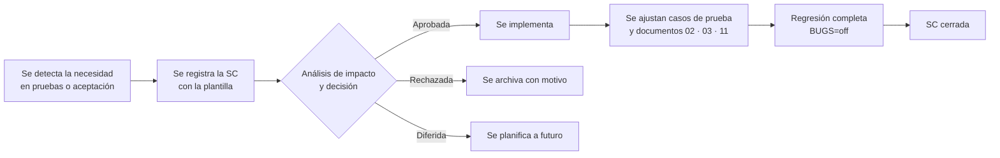

# 10 — Solicitudes de cambio

> Salida del proceso de pruebas. Una **solicitud de cambio (SC)** registra una mejora o modificación que surge de las pruebas y que **no es un defecto** respecto a los requerimientos (un defecto se gestiona en [09](09-hallazgo-de-defectos.md)). Su control evita cambios sin análisis de impacto.

## 1. Flujo de una solicitud de cambio

**Estados:** Registrada → En análisis → Aprobada / Rechazada / Diferida → Implementada → Verificada (cerrada).

## 2. Plantilla

| Campo | Contenido |
|---|---|
| **ID** | `SC-NNN` |
| **Título** | Frase corta del cambio |
| **Fecha / solicitante** | Fecha y rol de quien la registra |
| **Origen** | Caso de prueba, defecto o actividad (aceptación, exploración) de donde surge |
| **Tipo** | Mejora de usabilidad · Cambio funcional · Mejora técnica · Documentación |
| **Descripción y justificación** | Qué se propone y por qué |
| **Requerimientos afectados** | RF/RNF |
| **Análisis de impacto** | Código, casos de prueba, datos y documentos afectados |
| **Prioridad / esfuerzo** | Alta · Media · Baja / estimación |
| **Decisión y responsable** | Aprobada, rechazada o diferida, con fecha y motivo |
| **Estado** | Ver estados |
| **Verificación** | Casos ejecutados y resultado |

## 3. Solicitudes registradas

### SC-001 — Restaurar la cantidad válida cuando el carrito rechaza un valor

| Campo | Contenido |
|---|---|
| **ID** | SC-001 |
| **Fecha / solicitante** | 2026-10-03 · Analista de pruebas |
| **Origen** | Ejecución del caso de cantidades inválidas (hoy `CP-DEF-002`) con `BUGS=off`: la aserción «el campo no conserva el valor rechazado» falló en Chromium, Firefox y WebKit aunque el mensaje de error sí aparecía |
| **Tipo** | Mejora de usabilidad |
| **Descripción** | Al escribir una cantidad inválida (p. ej. `-3`) el sistema muestra correctamente «La cantidad debe ser un entero entre 1 y 99», pero el campo conserva el valor rechazado, de modo que la pantalla muestra un dato que no coincide con el carrito real. Se propone restaurar la última cantidad válida junto con el mensaje de error. |
| **Justificación** | El usuario podría creer que `-3` quedó registrado. No es un defecto del requerimiento RF-05 (el servidor rechaza el valor), pero afecta la claridad de la interfaz. |
| **Requerimientos afectados** | RF-05 |
| **Análisis de impacto** | Código: `app/public/js/app.js` (manejo del error en el cambio de cantidad), un cambio de una línea. Pruebas: `CP-DEF-002` verifica ahora que, tras rechazar una cantidad inválida, el total vuelva al valor correcto (Q25.00). Datos: ninguno. Documentos: [02](02-casos-de-prueba.md). |
| **Prioridad / esfuerzo** | Media / 15 minutos |
| **Decisión** | **Aprobada** (2026-10-03) por el líder de QA y el desarrollador del SUT |
| **Estado** | **Verificada (cerrada)** — implementada y cubierta por `CP-DEF-002` en Chromium, Firefox y WebKit |

### SC-002 — Validación en línea de los campos del checkout

| Campo | Contenido |
|---|---|
| **ID** | SC-002 |
| **Fecha / solicitante** | 2026-10-03 · Analista de pruebas |
| **Origen** | Pruebas de aceptación y datos dirigidos del checkout (`CP-E2E-005` y `CP-DD-002`) |
| **Tipo** | Mejora de usabilidad |
| **Descripción** | Hoy los errores del formulario de pago aparecen todos juntos **solo después de pulsar «Pagar ahora»**. Se propone validar cada campo al salir de él (evento *blur*) y mostrar el mensaje junto al campo, reutilizando las mismas reglas del servidor (teléfono de 8 dígitos, tarjeta de 16, vencimiento MM/AA, CVV de 3). |
| **Justificación** | Reduce el error y el abandono del pago: el usuario corrige a tiempo sin esperar al envío. Las 8 filas de datos negativos ya describen los mensajes esperados. |
| **Requerimientos afectados** | RF-07 (criterio de aceptación: «campos obligatorios y formatos válidos») |
| **Análisis de impacto** | Código: `app/public/js/app.js` (`viewCheckout`). Pruebas: agregar casos que verifiquen el mensaje al salir del campo, sin pulsar pagar, y confirmar que `CP-E2E-005` y `CP-DD-002` siguen pasando. Datos: se reutiliza `checkout-negativos.json`. Documentos: [02](02-casos-de-prueba.md), [03](03-requerimientos-y-trazabilidad.md) y [11](11-actualizacion-documentos.md). Riesgo: bajo; la validación del servidor se mantiene. |
| **Prioridad / esfuerzo** | Media / 2 horas (implementación) + 1 hora (pruebas) |
| **Decisión** | **Aprobada**, pendiente de implementación (se planifica para una siguiente iteración) |
| **Estado** | Aprobada |

## 4. Registro resumido

| ID | Título | Origen | Tipo | Prioridad | Estado |
|---|---|---|---|---|---|
| SC-001 | Restaurar la cantidad válida cuando el carrito rechaza un valor | CP-DEF-002 | Mejora de usabilidad | Media | Verificada (cerrada) |
| SC-002 | Validación en línea de los campos del checkout | CP-E2E-005, CP-DD-002 | Mejora de usabilidad | Media | Aprobada |
