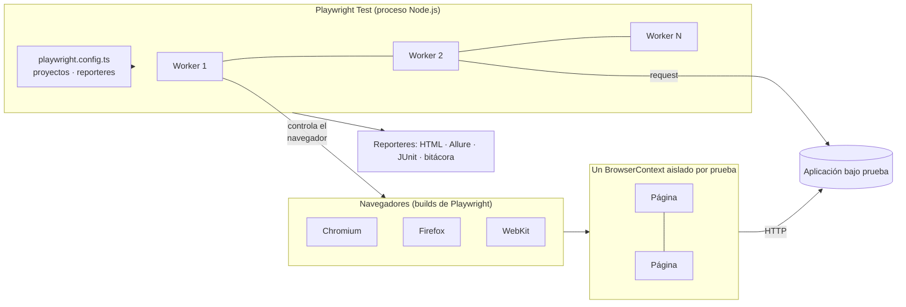

# 12 — Playwright: ventajas y limitaciones

> Documento de apoyo del proyecto. Las afirmaciones sobre las herramientas se respaldan con la documentación oficial (citas en formato APA 7, referencias al final) y con la experiencia directa de construir este proyecto. Las fuentes oficiales se consultaron el 3 de octubre de 2026 para la versión 1.63.0.

## 1. ¿Qué es Playwright?

Playwright Test es un *framework* de pruebas de extremo a extremo (E2E) para aplicaciones web modernas; incluye el ejecutor de pruebas, aserciones, aislamiento y paralelización (Microsoft, s. f.-a). Controla tres motores de navegador —**Chromium, WebKit y Firefox**— en Windows, Linux y macOS, de forma local o en integración continua, e incluye emulación nativa de dispositivos móviles. Se puede usar desde **Node.js (TypeScript/JavaScript), Python, Java y .NET** (Microsoft, s. f.-a). Este proyecto usa la versión **1.63.0** con TypeScript.

## 2. Uso principal

| Uso | Cómo se aprovechó en este proyecto |
|---|---|
| Pruebas E2E funcionales de la interfaz | `tests/e2e/`, con el patrón Page Object |
| Pruebas de API (`request`) | `tests/api/`, incluido el encadenado API + UI |
| Compatibilidad entre navegadores | La misma suite en Chromium, Firefox y WebKit |
| Pruebas móviles / responsive (emulación) | Pixel 7 e iPhone 14 en `tests/mobile/` |
| Simulación de red | `page.route` en `tests/network/` |
| Regresión visual | `toHaveScreenshot` en `tests/visual/` |
| Accesibilidad | `@axe-core/playwright` en `tests/a11y/` |
| Depuración y evidencia | Trace Viewer, video, capturas, UI Mode, codegen |

## 3. Arquitectura

Ideas clave:

1. **Aislamiento por contexto.** Cada prueba recibe su propio *Browser Context*, sin compartir cookies, `localStorage` ni `sessionStorage`; los contextos son rápidos y baratos de crear, y por eso las pruebas no se afectan entre sí ni dependen del orden de ejecución (Microsoft, s. f.-c).
2. **Builds propios de los navegadores.** Playwright usa sus propias compilaciones: Chromium de código abierto (por delante de Chrome estable), Firefox con parches específicos y WebKit derivado de las fuentes recientes. Se pueden usar Chrome o Edge estables mediante la opción `channel` (Microsoft, s. f.-b).
3. **Auto-waiting y *actionability*.** Antes de actuar, Playwright comprueba que el elemento esté visible, estable, habilitado y reciba eventos (y editable al escribir); si no se cumple, espera hasta el límite de tiempo (Microsoft, s. f.-e). Por eso este proyecto prohíbe las esperas fijas.
4. **Proyectos y *workers*.** Una misma prueba se ejecuta en varios proyectos (navegador/dispositivo) y en paralelo; las *fixtures* preparan el estado de cada prueba.
5. **Trazas.** El Trace Viewer permite recorrer cada acción con instantáneas del DOM, red y consola; se recomienda grabarlo en el primer reintento (`on-first-retry`) en integración continua (Microsoft, s. f.-h).

## 4. Ventajas

| # | Ventaja | Evidencia en este proyecto |
|---|---|---|
| 1 | **Un solo framework para E2E, API, visual, accesibilidad y móvil**, con un mismo ejecutor y reportes | 25 casos de 9 clases de prueba en un único `npm test` |
| 2 | **Multinavegador real** (Chromium, Firefox y WebKit) con el mismo código | 59 ejecuciones; WebKit corrió en Linux sin configuración extra |
| 3 | **Auto-waiting** que reduce la inestabilidad (Microsoft, s. f.-e) | 0 esperas fijas en toda la suite; sin pruebas inestables en las corridas de referencia |
| 4 | **Aislamiento y paralelismo** nativos (Microsoft, s. f.-c) | Suite completa en ≈ 27 s con `BUGS=off` usando 4 *workers* |
| 5 | **Herramientas de depuración** de primera línea: Trace Viewer, UI Mode, `codegen`, video y capturas (Microsoft, s. f.-h) | Cada fallo deja `trace.zip`, captura y video |
| 6 | **Selectores centrados en el usuario** (`getByRole`, `getByLabel`, `getByTestId`) y aserciones que reintentan (Microsoft, s. f.-d) | Pruebas legibles y resistentes a cambios de CSS |
| 7 | **Simulación de red** (`page.route`) para probar fallos que son difíciles de provocar de verdad (Microsoft, s. f.-d) | Servicio caído, respuesta lenta, catálogo vacío, 401 y 409 |
| 8 | **Fixtures tipadas** y TypeScript: reutilización y autocompletado | `clienteNuevo`, `carritoUI`, `adminApi`… |
| 9 | **Emulación de dispositivos** con una línea de configuración (Microsoft, s. f.-f) | Proyectos `mobile-pixel7` y `mobile-iphone14` |
| 10 | **Extensible**: reporteres propios y librerías de terceros | Reporter de bitácora SQLite, Allure y axe-core |
| 11 | **Fácil de llevar a CI y a contenedores** (imagen oficial con los navegadores) | Dockerfile y workflow de GitHub Actions |

## 5. Limitaciones (honestas)

| # | Limitación | Detalle y experiencia en este proyecto |
|---|---|---|
| 1 | **No usa los navegadores de marca instalados** | Funciona con sus propios builds de Chromium, Firefox y WebKit (Microsoft, s. f.-b). El WebKit de Playwright no es el Safari de un iPhone o Mac: «pasar en WebKit» no garantiza «pasar en Safari real». |
| 2 | **Móvil = emulación, no dispositivos reales** | Se emulan agente de usuario, tamaño de pantalla, *viewport*, soporte táctil y densidad de píxeles (Microsoft, s. f.-f). No detecta problemas propios del hardware, del teclado virtual o del rendimiento real. |
| 3 | **Las capturas visuales dependen del entorno** | «Los resultados de renderizado varían según el sistema operativo, la versión, la configuración, el hardware, el modo headless y otros factores» y se recomienda ejecutar donde se generó la línea base (Microsoft, s. f.-i). **Lo comprobamos:** las capturas del equipo fallaron dentro de Docker por las tipografías, y hubo que mantener una línea base por entorno (`ENTORNO_VISUAL`). |
| 4 | **La accesibilidad automatizada es parcial** | Las pruebas automáticas detectan algunos problemas comunes, pero muchos solo se descubren con pruebas manuales (Microsoft, s. f.-g). Axe-core encontró BUG-004, pero no sustituye la revisión con lector de pantalla ni teclado. |
| 5 | **Requisitos de plataforma** | Playwright 1.63 requiere Node.js 22, 24 o 26 y sistemas operativos concretos (Windows 11+, macOS 14+, Debian 12/13 y Ubuntu 22.04/24.04/26.04) (Microsoft, s. f.-a). En otras distribuciones hay que usar Docker. |
| 6 | **Peso en disco y tiempo de instalación** | Los tres navegadores ocupan ≈ 1.3 GB y la imagen Docker ≈ 3 GB (medido en este proyecto). |
| 7 | **Solo aplicaciones web** | Es un *framework* para aplicaciones web modernas y soporta tres motores (Microsoft, s. f.-a); no es una herramienta para aplicaciones de escritorio ni para navegadores fuera de esos motores. |
| 8 | **Curva de aprendizaje** | Todo es asíncrono (`async/await`), y conviene dominar *fixtures*, proyectos y aserciones web-first. Un `await` olvidado produce fallos difíciles de ver. |
| 9 | **Los reintentos pueden esconder inestabilidad** | Por eso la bitácora distingue el estado *Inestable* (falló y pasó al reintentar) y se investiga en vez de tolerarse. |
| 10 | **Los pasos automáticos no bastan para redactar un defecto** | En este proyecto los pasos de bajo nivel («Navigate», «Evaluate») carecen del detalle necesario para reproducir, por lo que se mantuvo un catálogo (`defectos-catalogo.json`) con los pasos de cada defecto. |
| 11 | **Módulos nativos del proyecto** | No es propio de Playwright, pero afectó al ambiente: `better-sqlite3` necesitó un compilador dentro de Docker. |

## 6. Comparación breve con Selenium y Cypress

| Aspecto | **Playwright** | **Selenium** | **Cypress** |
|---|---|---|---|
| Qué es | *Framework* de pruebas E2E para web: ejecutor, aserciones, aislamiento y paralelización incluidos (Microsoft, s. f.-a) | Proyecto «paraguas» de herramientas y librerías: WebDriver, Grid, IDE y Selenium Manager (Selenium, s. f.-a) | Herramienta especializada en pruebas E2E, de componentes y de API; no es una herramienta de automatización general (Cypress.io, s. f.-a) |
| Cómo controla el navegador | Controla sus propios builds de Chromium, Firefox y WebKit (Microsoft, s. f.-b) | Implementa la especificación **W3C WebDriver**, un protocolo remoto con puntos finales HTTP y neutral al lenguaje (Selenium, s. f.-a; W3C, 2026) | Las pruebas **se ejecutan dentro del navegador** (Cypress.io, s. f.-a) |
| Lenguajes | JavaScript/TypeScript, Python, Java y .NET (Microsoft, s. f.-a) | Java, Python, C#, Ruby, JavaScript y Kotlin (Selenium, s. f.-a) | Solo JavaScript en el código de prueba (Cypress.io, s. f.-a) |
| Sincronización | **Auto-waiting** con comprobaciones de *actionability* (Microsoft, s. f.-e) | Esperas implícitas, explícitas y *fluent*; la sincronización es un desafío común y puede producir pruebas inestables (Selenium, s. f.-b) | Reintento automático de consultas y aserciones (4 s por defecto); las acciones se ejecutan una sola vez tras esperar condiciones de preparación (Cypress.io, s. f.-b) |
| Varias pestañas / navegadores a la vez | Varias páginas y contextos aislados por prueba (Microsoft, s. f.-c) | **Grid** reparte la asignación de navegadores para escalar la ejecución (Selenium, s. f.-a) | No controla más de un navegador abierto a la vez; las pestañas múltiples requieren un plugin (Cypress.io, s. f.-a) |
| Varios orígenes (dominios) en un test | Sin restricción especial en el uso normal | Sin restricción especial | Cada prueba se limita a un *superdominio*; los demás requieren `cy.origin` (Cypress.io, s. f.-a) |
| Depuración | Trace Viewer, UI Mode, codegen, video (Microsoft, s. f.-h) | **Selenium IDE**: extensión del navegador para grabar y reproducir (Selenium, s. f.-a) | No verificado en las fuentes consultadas |
| Móvil | Emulación de dispositivos (Microsoft, s. f.-f) | No verificado en las fuentes consultadas | Sin soporte de eventos nativos ni móviles, según sus limitaciones temporales documentadas (Cypress.io, s. f.-a) |
| Escalado | Paralelismo entre *workers* (Microsoft, s. f.-a) y fragmentación de la suite (`--shard`, usada en el flujo de CI de este proyecto) | **Grid** distribuye la ejecución (Selenium, s. f.-a) | No verificado en las fuentes consultadas |

> La comparación se limita a lo que dicen las documentaciones oficiales citadas. Las tres herramientas evolucionan rápido; antes de decidir en un proyecto real conviene revisar las versiones vigentes.

## 7. ¿Cuándo elegir Playwright?

**Es buena opción cuando…** se prueba una aplicación web moderna, se necesita la misma suite en varios motores, se quiere combinar UI y API en un solo lugar, el equipo trabaja con JavaScript/TypeScript, Python, Java o .NET, y se valora la depuración con trazas y la ejecución rápida en CI.

**Conviene considerar otra herramienta (o complementarla) cuando…** hay que certificar en dispositivos físicos o en Safari/Chrome de marca (nubes de dispositivos), el equipo necesita un lenguaje que Playwright no soporta (Ruby, Kotlin, C# nativo de Selenium), se prueban aplicaciones nativas, o ya existe una gran inversión en Selenium Grid.

## 8. Lecciones de este proyecto

1. **Las pruebas fallan por buenas razones.** Con `BUGS=on` los 19 fallos esperados señalan a 5 causas, y cada una quedó con evidencia reproducible.
2. **El entorno importa.** Probar en Docker destapó dependencias ocultas: compilador para módulos nativos, permisos de volúmenes y tipografías.
3. **La independencia de las pruebas es un requisito de diseño**, no un detalle: sin un cliente nuevo por prueba, el paralelismo habría producido fallos intermitentes.
4. **La automatización complementa, no reemplaza, la prueba manual**: accesibilidad y percepción de usabilidad necesitan personas.

## 9. Referencias (APA 7)

Cypress.io. (s. f.-a). *Trade-offs*. Cypress Documentation. Recuperado el 3 de octubre de 2026, de https://docs.cypress.io/app/references/trade-offs

Cypress.io. (s. f.-b). *Retry-ability*. Cypress Documentation. Recuperado el 3 de octubre de 2026, de https://docs.cypress.io/app/core-concepts/retry-ability

IEEE. (2008). *IEEE standard for software and system test documentation* (IEEE Std 829-2008). https://ieeexplore.ieee.org/document/4578383

ISO/IEC/IEEE. (2021). *Software and systems engineering — Software testing — Part 3: Test documentation* (ISO/IEC/IEEE Standard No. 29119-3:2021). International Organization for Standardization. https://www.iso.org/standard/79429.html

ISTQB. (2023). *Certified Tester Foundation Level (CTFL) syllabus v4.0*. International Software Testing Qualifications Board. https://istqb.org/certifications/certified-tester-foundation-level-ctfl-v4-0/

Kirkpatrick, A., O Connor, J., Campbell, A., & Cooper, M. (Eds.). (2025). *Web content accessibility guidelines (WCAG) 2.1* [Recomendación del W3C]. World Wide Web Consortium. https://www.w3.org/TR/WCAG21/

Microsoft. (s. f.-a). *Installation*. Playwright. Recuperado el 3 de octubre de 2026, de https://playwright.dev/docs/intro

Microsoft. (s. f.-b). *Browsers*. Playwright. Recuperado el 3 de octubre de 2026, de https://playwright.dev/docs/browsers

Microsoft. (s. f.-c). *Isolation*. Playwright. Recuperado el 3 de octubre de 2026, de https://playwright.dev/docs/browser-contexts

Microsoft. (s. f.-d). *Best practices*. Playwright. Recuperado el 3 de octubre de 2026, de https://playwright.dev/docs/best-practices

Microsoft. (s. f.-e). *Auto-waiting*. Playwright. Recuperado el 3 de octubre de 2026, de https://playwright.dev/docs/actionability

Microsoft. (s. f.-f). *Emulation*. Playwright. Recuperado el 3 de octubre de 2026, de https://playwright.dev/docs/emulation

Microsoft. (s. f.-g). *Accessibility testing*. Playwright. Recuperado el 3 de octubre de 2026, de https://playwright.dev/docs/accessibility-testing

Microsoft. (s. f.-h). *Trace viewer*. Playwright. Recuperado el 3 de octubre de 2026, de https://playwright.dev/docs/trace-viewer-intro

Microsoft. (s. f.-i). *Visual comparisons*. Playwright. Recuperado el 3 de octubre de 2026, de https://playwright.dev/docs/test-snapshots

Selenium. (s. f.-a). *The Selenium browser automation project*. Recuperado el 3 de octubre de 2026, de https://www.selenium.dev/documentation/

Selenium. (s. f.-b). *Waiting strategies*. Recuperado el 3 de octubre de 2026, de https://www.selenium.dev/documentation/webdriver/waits/

World Wide Web Consortium. (2026, 2 de julio). *WebDriver* [Borrador de trabajo del W3C]. https://www.w3.org/TR/webdriver2/

> **Nota sobre la verificación de fuentes:** todas las URL se consultaron el 3 de octubre de 2026, salvo la de IEEE Std 829-2008, cuyo sitio bloquea la lectura automática; se incluye el enlace de IEEE Xplore y el estándar está confirmado por otras fuentes (publicado el 18 de julio de 2008 y sustituido por la serie ISO/IEC/IEEE 29119). Verifica ese enlace antes de entregar el trabajo.
